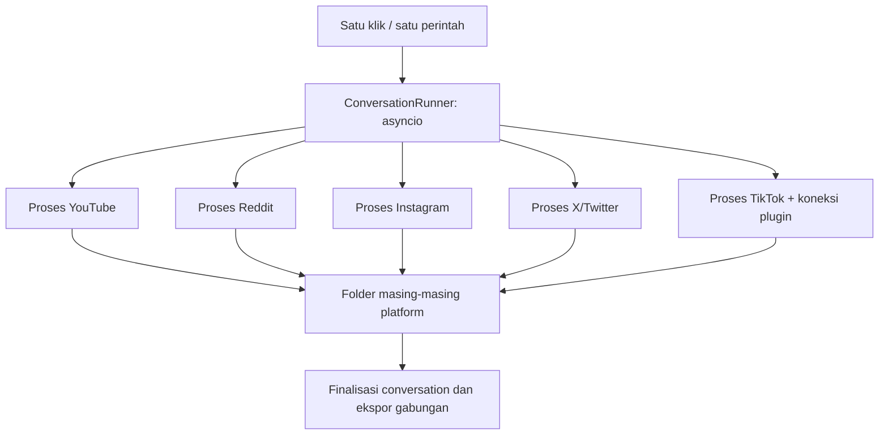

# Rencana conversation crawling paralel

**Status: frontend conversation-first tersedia, backend runner masih direncanakan, 7 November 2026.** Library/editor conversation, generator-draft dari judul, snapshot versi, pemilihan conversation pada tiap platform, serta review crawling parallel telah diimplementasikan pada frontend React. Adapter demo tidak menjalankan crawling nyata. Conversation runner Python, endpoint HTTP nyata, pemanggilan Gemini server-side, persistensi backend, dan format output di bawah tetap rencana tahap berikutnya.

## 1. Hasil yang dituju

Satu klik atau satu perintah eksekusi membuat **satu conversation**, lalu langsung
menjalankan crawler seluruh platform yang dipilih secara paralel. Setiap platform
mempunyai proses, koneksi, checkpoint, dan folder output sendiri. Semua proses
menggunakan konfigurasi teks conversation yang sama.

Ketentuan utama:

- Platform awal: YouTube, Reddit, Instagram, X/Twitter, dan TikTok.
- Eksekusi antarplatform benar-benar bersamaan; tidak memakai giliran
  `round_robin`, antrean conversation, atau penjadwalan berkala.
- Di dalam platform, batas request, pacing, cooldown, dan penghalang akses tetap
  berlaku. Paralel antarplatform tidak meningkatkan concurrency HTTP adapter.
- Menunggu plugin atau sesi pada satu platform tidak menahan platform lain.
- Satu platform gagal tidak membatalkan seluruh hasil conversation.
- Satu conversation menjadi satu unit konfigurasi, pemantauan, pemulihan, dan ekspor.
  Hasil yang sudah diperoleh dipertahankan ketika sebagian pekerjaan gagal.

## 2. Kondisi aplikasi sekarang

Komponen berikut sudah tersedia dan akan digunakan kembali:

| Komponen                                                             | Kondisi sekarang                                                                                                           | Perubahan yang direncanakan                                                                               |
| -------------------------------------------------------------------- | -------------------------------------------------------------------------------------------------------------------------- | --------------------------------------------------------------------------------------------------------- |
| [SocialCrawler](../../Crawler/Backend/social_crawler.py)             | Menggabungkan adapter, filter, deadline, progres, dan ekspor. `round_robin` bergantian menjalankan operasi yang memblokir. | Jalankan satu instance dengan konfigurasi satu platform di setiap proses worker.                          |
| [Konfigurasi universal](../../config/social_crawler.json)            | Include/exclude dan query bersama tersedia; beberapa pengaturan bisa dioverride per platform.                              | Conversation membekukan satu konfigurasi teks bersama tanpa override teks per platform.                   |
| [Arsip sosial](../../Crawler/Backend/social_archive.py)              | Mengorganisasi hasil per platform/tanggal dan menduplikasi berdasarkan ID.                                                 | Tambahkan publikasi yang dibatasi oleh conversation; arsip global menjadi ekspor terpisah yang eksplisit. |
| [ContextRelevanceFilter](../../MachineLearning/context_relevance.py) | Memiliki contoh relevant/generic/irrelevant, fingerprint, cache, dan klasifikasi batch.                                    | Gunakan satu snapshot kebijakan relevansi untuk seluruh sumber dalam conversation.                        |
| [Kontrak frontend](../../Crawler/Frontend/docs/API_CONTRACT.md)      | Kontrak integrasi tersedia; layanan HTTP crawling nyata belum tersedia.                                                    | Implementasikan penghubung frontend ke conversation runner yang berjalan di backend.                      |

Frontend versi 1.3 sudah memisahkan menu **Persiapan → Conversation** dari **Crawling → Parallel/platform**, dan membekukan `ConversationSnapshot` ke setiap plan. Implementasi ini merupakan kontrak/UI dan simulasi, bukan bukti subprocess paralel atau isolasi worker backend sudah tersedia.

Folder dan hasil lama tetap dipertahankan. Implementasi baru tidak memindahkan
atau menulis ulang dataset historis secara otomatis.

## 3. Teknik paralel

Pilihan untuk versi pertama: **proses Python terpisah per platform, diawasi oleh
proses induk berbasis `asyncio`**, pada satu komputer/server.



Proses induk menggunakan `asyncio.create_subprocess_exec()` dengan daftar
argumen, lalu mengawasi seluruh subprocess secara bersamaan. Setiap worker
menerima konfigurasi yang hanya mengaktifkan platform miliknya; jangan
menjalankan konfigurasi lima platform penuh pada setiap worker.

Tanggung jawab proses induk:

1. Memvalidasi dan membekukan konfigurasi conversation.
2. Membuat ID, direktori, dan kepemilikan conversation secara atomik.
3. Meluncurkan semua worker platform tanpa menunggu satu worker selesai dahulu.
4. Membaca event/progres dan log worker secara terus-menerus dengan buffer terbatas.
5. Menangani error setiap worker sebagai hasil platform tersebut.
6. Mengurus pause, stop, deadline, pemulihan, dan finalisasi conversation.

Adapter yang ada tetap menangani pengambilan data dan kebijakan requestnya.
Adapter dapat membuat subprocess atau browser tambahan; lima worker platform
tidak berarti hanya ada lima proses OS.

Pengawasan tidak boleh menyebabkan kegagalan satu worker membatalkan worker
lain. Jika memakai `TaskGroup`, tangani error platform di dalam task pengawas;
alternatifnya gunakan `gather(return_exceptions=True)` dan periksa semua hasil.
Pembatalan conversation tetap harus melakukan cleanup subprocess secara eksplisit.

Untuk frontend, runner dimiliki layanan backend yang hidup terpisah dari satu
request HTTP. Menutup tab frontend tidak menghentikan conversation. Untuk CLI
mandiri, proses CLI menjadi pemilik runner; interrupt melakukan stop terkontrol.

## 4. Identitas dan struktur output

`conversation_id` adalah ID stabil dan unik. Nama folder menggabungkan tanggal WIB,
ID pendek, dan slug nama conversation, misalnya:

```text
outputs/crawling/20261106-a81f29c0-riset-kampus/
├── conversation.json                    # Identitas dan snapshot konfigurasi publik
├── state.json                       # Status dan kepemilikan runtime
├── progress.json                    # Snapshot progres untuk UI
├── events.jsonl                     # Event conversation, ditulis proses induk
├── manifest.json                    # Daftar artefak final dan checksum
├── youtube/
│   ├── checkpoint.json
│   ├── events.jsonl                 # Jurnal event worker untuk pemulihan
│   ├── attempts/
│   │   ├── 0001/                   # Bundle audit hasil satu percobaan
│   │   └── 0002/
│   └── social_data.xlsx            # Hasil unik platform versi terakhir
├── reddit/                         # Struktur sama dengan youtube/
├── instagram/
├── twitter/
├── tiktok/
├── combined/
│   ├── social_data.xlsx
│   └── merge_report.json
└── relevance/
    ├── relevance_decisions.parquet
    ├── filtered_sentences.parquet
    └── relevance_report.json
```

- Nama tampilan conversation dapat berubah tanpa mengganti ID atau lokasi datanya.
- Nama folder X menggunakan `twitter`, mengikuti nama internal backend saat ini.
- `attempt_id` membedakan percobaan platform di dalam conversation yang sama.
- Resume menambah attempt bila diperlukan; bundle attempt lama tidak ditimpa.
- Timestamp audit memakai UTC dengan timezone; tanggal folder dan tampilan UI
  mengikuti Asia/Jakarta.
- Manifest final mengikat artefak yang sudah dipublikasikan. File progres yang
  masih berubah tidak diperlakukan sebagai artefak final dengan checksum tetap.

Worker memakai `output_dir` eksplisit di folder attempt. Organizer global lama
tidak dijalankan otomatis dari masing-masing worker. Proses induk memublikasikan
hasil conversation setelah validasi dan deduplikasi.

## 5. Satu konfigurasi teks bersama

| Selalu sama dalam satu transaksi parallel  | Boleh khusus platform                               |
| ------------------------------------------ | --------------------------------------------------- |
| Keyword include, exclude, dan include mode | Adapter/backend dan metode autentikasi              |
| Queries dan daftar hashtag sumber          | Referensi sesi, akun, atau konektor                 |
| Rentang tanggal publikasi dari transaksi   | Subreddit dan sumber URL yang sesuai platform       |
| Kebijakan exclude komentar                 | Target, batas komentar/balasan, dan timeout adapter |
| Scope dan contoh kalimat relevansi         | Batas request dan cooldown sesuai adapter           |
| Model, revision, dan threshold relevansi   | Dukungan metode pencarian platform                  |

Daftar queries/hashtag mempunyai satu sumber. Adapter menerapkan metode
discovery sesuai kemampuannya. Contohnya, Instagram memakai pencarian hashtag;
Reddit mempunyai pembatas subreddit. Metode yang tidak didukung harus terlihat
dalam preview rencana efektif. Validasi memastikan setiap platform aktif punya
jalur discovery yang didukung; jangan diam-diam mengganti atau membuang input.

Konfigurasi bersama berarti kebijakan dan input riset konsisten, bukan jaminan
bahwa semua platform mempunyai kemampuan atau hasil pencarian identik.

`relevant sentences` berarti **contoh/acuan untuk menilai relevansi**. Kalimat
hasil crawling tetap berasal dari sumber dan boleh berbeda. Acuan relevant,
generic, dan irrelevant, scope, serta model/revision/threshold dibekukan bersama.

Saat mulai, simpan snapshot konfigurasi publik dan `config_hash`. Seluruh worker
melaporkan hash yang sama. Preview efektif juga mencatat penerjemahan discovery
ke tiap adapter. Perubahan teks atau kebijakan relevansi membutuhkan conversation
baru; resume mempertahankan snapshot asli.

Contoh bentuk konfigurasi **usulan**, belum diterima parser saat ini:

```json
{
  "schema_version": 1,
  "name": "Riset Kampus",
  "execution": {
    "mode": "parallel_processes",
    "total_seconds": 3600,
    "since": "2025-11-06T00:00:00+07:00",
    "until": "2026-11-07T00:00:00+07:00"
  },
  "shared": {
    "include_keywords": ["kuliah", "kampus"],
    "exclude_keywords": ["judi"],
    "include_mode": "any",
    "comment_exclude_keywords": [],
    "queries": ["biaya kuliah", "pengalaman kampus"],
    "hashtags": ["kuliah", "kampus"],
    "relevance": {
      "scope": "Pengalaman dan pertimbangan pendidikan tinggi",
      "references": {
        "relevant": [
          "Biaya kuliah dan fasilitas kampus memengaruhi pilihan saya."
        ],
        "generic": ["Terima kasih atas informasinya."],
        "irrelevant": ["Saya sedang memperbaiki kendaraan."]
      }
    }
  },
  "platforms": {
    "youtube": { "enabled": true },
    "reddit": { "enabled": true, "subreddits": ["indonesia"] },
    "instagram": { "enabled": true, "auth_ref": "instagram-main" },
    "twitter": { "enabled": true, "auth_ref": "twitter-main" },
    "tiktok": { "enabled": true, "connector_ref": "chrome-local" }
  }
}
```

Validator nantinya melengkapi default dan membekukan seluruh nilai efektif,
termasuk model yang dipin, sebelum start. Contoh ini tidak memuat kredensial dan
tidak menggantikan `config/social_crawler.json` pada commit dokumentasi ini.

## 6. Sesi, plugin, dan batas sumber daya

- Setiap platform membaca kredensial dari penyimpanan server melalui referensi
  yang terotorisasi. Nilai session ID, cookie, token, dan pairing secret tidak
  disalin ke snapshot, argumen command, log, atau folder conversation.
- Satu akun/sesi/profil browser hanya boleh dimiliki satu worker aktif. Gunakan
  lock yang didasarkan pada identitas resource, bukan hanya conversation ID.
- Koneksi plugin TikTok diikat ke conversation, platform, dan attempt aktif.
  Event koneksi lama tidak boleh diterima oleh attempt baru.
- Status `WAITING_CONNECTION` ditampilkan pada platform yang belum siap. Worker
  lain tetap berjalan. Sesi tidak valid tidak memicu refresh tanpa batas.
- Versi pertama membatasi satu conversation aktif per host. Start conversation kedua
  ditolak dengan alasan yang jelas, tanpa antrean tersembunyi.
- Preflight memeriksa kapasitas proses/browser dan konflik resource. Jika host
  tidak mampu menjalankan seluruh pilihan sekaligus, operator perlu mengurangi
  platform atau menambah kapasitas. Eksekusi tidak berubah diam-diam menjadi serial.

## 7. Progres, status, dan durasi

Status conversation yang direncanakan:

```text
DRAFT → READY → RUNNING → FINALIZING → COMPLETED / PARTIAL / FAILED
                  ↕
                PAUSED
                  ↓
             CANCELLING → CANCELLED
```

Cancel dapat diminta dari setiap status aktif; operator tidak perlu pause dahulu.

| Status akhir | Arti                                                                                                                     |
| ------------ | ------------------------------------------------------------------------------------------------------------------------ |
| `COMPLETED`  | Semua target platform terpilih dan tahap wajib conversation selesai; bukan klaim seluruh komentar sumber telah tersedia. |
| `PARTIAL`    | Ada hasil yang valid, tetapi target/tahap wajib belum selesai atau sebagian platform mengalami barrier/error.            |
| `FAILED`     | Conversation tidak menghasilkan hasil valid akibat kegagalan eksekusi fatal.                                             |
| `CANCELLED`  | Operator menghentikan conversation; hasil valid yang sudah tersimpan tetap dapat diekspor.                               |

Status platform dibedakan, misalnya `STARTING`, `WAITING_CONNECTION`, `RUNNING`,
`COOLDOWN`, `PAUSED`, `TARGET_REACHED`, `EXHAUSTED`, `BLOCKED`, `FAILED`, dan
`CANCELLED`. Platform menunggu dapat kembali berjalan setelah koneksi valid
selama conversation dan anggarannya masih aktif.

Progres memisahkan post, post yang memenuhi target, komentar, balasan, duplikat,
penolakan filter, dan alasan berhenti. Hitung dari identitas record yang diterima,
bukan sekadar menjumlahkan ulang event atau memakai jumlah baris preview UI.

Keputusan durasi untuk versi pertama:

- `total_seconds` berlaku untuk seluruh conversation sejak proses induk mulai
  mengeksekusi conversation; bukan durasi baru untuk setiap platform.
- Menunggu koneksi, pause, dan cooldown tetap menghabiskan durasi conversation bila
  batas diisi. `null` berarti tanpa deadline keseluruhan.
- Simpan deadline absolut agar restart tidak mereset anggaran. Timeout request
  dan deadline adapter tetap berlaku di dalam sisa anggaran tersebut.
- Event TikTok `crawling_started` tetap membutuhkan pairing/handshake yang sah;
  waktu menunggu dicatat terpisah dari waktu crawling aktif.
- Perpanjangan durasi harus eksplisit dan tercatat sebagai perubahan runtime.
  Snapshot kebijakan teks conversation tidak berubah.

## 8. Checkpoint, resume, dan penghentian

Setiap platform menyimpan checkpoint setelah batch yang telah diterima dengan
identitas native yang terverifikasi. Checkpoint memuat versi format, attempt,
progres discovery/thread, ID yang sudah dipublikasikan atau referensi indeksnya,
serta batas cooldown yang belum lewat. Kredensial tetap di luar checkpoint.

Kemampuan resume harus sesuai adapter:

- Pakai cursor bila adapter mendukung cursor yang aman untuk digunakan kembali.
- Bila SDK tidak mendukung cursor, ulangi root yang parsial dan deduplikasi ID
  yang sudah disimpan. Jangan mengklaim lanjut persis dari posisi terakhir.

Proses induk menjadi satu-satunya penulis status/manifest conversation. Worker hanya
menulis jurnal dan data platformnya. Event mempunyai nomor urut dan identitas
attempt; pemutaran ulang event tidak boleh menggandakan record atau counter.
Publikasi snapshot/checkpoint menggunakan temporary file dan atomic replace.
Periksa juga jalur abort/staging `BundleSink` agar exception tidak menghapus
jurnal atau bukti parsial yang dibutuhkan untuk pemulihan conversation.

Urutan stop: minta worker berhenti, selesaikan checkpoint pada batas aman,
finalisasikan data parsial, lalu lepaskan resource. Jika melewati grace timeout,
hentikan proses milik worker dan catat penghentian paksa.

Adapter sekarang dapat membuat anak proses dengan process group tersendiri.
Cleanup wajib melacak seluruh turunan yang dimiliki worker, bukan hanya PID
langsung. Jangan menghentikan semua proses Chrome atau menutup Chrome pengguna
yang dipakai plugin.

Setelah crash, runner membaca state dan jurnal, memeriksa kepemilikan proses lama,
dan merekonsiliasi artefak sebelum melanjutkan. Resume hanya boleh mengambil alih
setelah pemilik lama dipastikan tidak aktif. Generasi attempt baru menolak event
terlambat dari worker lama.

## 9. Deduplikasi, relevansi, dan ekspor

- Kunci deduplikasi hasil berada dalam cakupan conversation dengan identitas sumber,
  namespace, dan native ID. ID yang sama dari platform berbeda tetap berbeda.
- Baseline dari conversation lain hanya digunakan bila dipilih dan dicatat dalam
  snapshot. Kemunculan post pada conversation lama tidak otomatis menghapusnya dari
  conversation baru.
- Data mentah dan bukti audit disimpan. Filter keyword/exclude root berlaku
  sebelum pengambilan anak bila metadata yang diperlukan tersedia.
- Relevansi kalimat dihitung secara batch setelah data diterima. Gunakan satu
  proses analisis khusus agar model tidak dimuat ulang oleh lima worker crawling.
- Hasil relevansi berada terpisah dari data sumber. Model, revision, threshold,
  fingerprint, keputusan dan alasan dicatat; tidak mengubah teks asli.
- Kegagalan proses relevansi tidak menghentikan pengambilan data sumber. Tahap
  relevansi yang diwajibkan tetapi belum selesai membuat conversation `PARTIAL`.
- Proses induk memublikasikan Excel per platform dan gabungan hanya dari artefak
  yang telah diverifikasi. File gabungan mempunyai laporan jumlah per sumber,
  duplikat, penolakan, dan checksum.
- Penentuan input NLP/training serta penggantian dataset dashboard tetap tindakan
  terpisah dan eksplisit. Membuat conversation tidak otomatis menjalankan training
  atau mengganti dashboard aktif.

## 10. Pengalaman frontend dan kontrak eksekusi

Alur operator:

1. Buat conversation dan isi nama/deskripsi.
2. Isi konfigurasi teks bersama serta acuan relevansi satu kali.
3. Pilih platform, target, batas teknis, dan referensi koneksi masing-masing.
4. Lihat preview konfigurasi efektif dan kesiapan resource.
5. Klik **Jalankan Conversation** sekali.
6. Pantau ringkasan conversation dan kartu progres masing-masing platform.
7. Pause, lanjutkan, hentikan, atau unduh hasil conversation tersebut.

Request start harus idempoten: double-click atau retry HTTP mengembalikan
conversation yang sama, bukan membuat lima worker tambahan. Backend memvalidasi izin
proyek, snapshot, resource, serta kepemilikan koneksi sebelum eksekusi.

Respons start mengembalikan `conversation_id`; backend melanjutkan pekerjaan setelah
respons selesai. UI membaca snapshot/event dari backend dan dapat tersambung
kembali setelah refresh. Nama endpoint final diselaraskan dengan kontrak
`acquisition-jobs` yang sudah dirancang.

Usulan CLI, **belum tersedia**:

```sh
python -m Crawler.Backend.conversation --config config/conversation.json
python -m Crawler.Backend.conversation --resume <conversation_id>
```

## 11. Tahapan implementasi dan kriteria penerimaan

| Tahap                   | Pekerjaan                                                                    | Bukti selesai                                                                                 |
| ----------------------- | ---------------------------------------------------------------------------- | --------------------------------------------------------------------------------------------- |
| 1. Kontrak conversation | Validator, snapshot/hash, ID, folder, status dan versi checkpoint.           | Semua platform menerima konfigurasi bersama yang sama; path aman dan data lama tidak ditimpa. |
| 2. Runner paralel       | Launcher subprocess, pengawas asyncio, event/log, deadline dan cleanup.      | Seluruh worker siap dimulai sebelum worker pertama diizinkan selesai pada fixture barrier.    |
| 3. Pemulihan            | Checkpoint, attempt, deduplikasi, lock sesi, pause/stop, rekonsiliasi crash. | Resume tidak menggandakan data atau menjalankan dua pemilik sesi yang sama.                   |
| 4. Artefak              | Hasil per platform, gabungan, proses relevansi dan manifest.                 | Jumlah/ID/checksum cocok; kebijakan relevansi identik lintas platform.                        |
| 5. Backend dan UI       | Endpoint nyata, idempotensi, form bersama, koneksi dan pemantauan.           | Satu klik menghasilkan satu conversation; refresh/menutup UI tidak menghentikannya.           |
| 6. Validasi runtime     | Tes integrasi, benchmark, pemeriksaan image dan arsitektur.                  | Kriteria di bawah lulus; batas performa dan kondisi parsial terdokumentasi.                   |

Tes penting:

- Buktikan proses platform berbeda dan benar-benar overlap, bukan hanya label
  status `RUNNING`. Pakai sinkronisasi fixture, bukan hanya asumsi dari durasi.
- Matikan satu worker; worker lain dan hasilnya tetap tersedia.
- Tahan plugin TikTok; platform lain tetap menghasilkan record.
- Kirim log banyak; buffer tetap terbatas dan worker tidak macet.
- Uji 429/Retry-After, 5xx, sesi tidak valid, dan stagnasi tanpa request lanjutan
  yang melanggar kebijakan adapter.
- Uji interrupt, batas durasi, pause/resume, crash parent, event terlambat, serta
  cleanup seluruh turunan worker tanpa menutup browser pengguna.
- Uji double start dan konflik sesi/conversation aktif; tidak ada proses ganda.
- Uji gabungan, deduplikasi antar-namespace, konfigurasi beku, dan resume dari
  adapter yang hanya mendukung replay root.
- Uji otorisasi, redaksi kredensial, akses unduhan, dan pemulihan UI.

Benchmark membandingkan fixture serial dan paralel dengan pekerjaan serta ID
hasil yang sama. Ukur durasi, RAM puncak, CPU, jumlah request, waktu menunggu,
error, dan data yang tersimpan. Performa live diuji terpisah; paralel lima platform
tidak otomatis berarti lima kali lebih cepat atau menjamin bebas blokir.

## 12. Batas versi pertama dan delivery

Target awal adalah satu conversation aktif pada satu host dengan lima adapter yang
sudah tersedia. Worker terdistribusi, eksekusi beberapa host, antrean conversation,
penjadwalan berkala, serta backend Threads/Facebook berada di luar versi pertama.

Tidak ada kebutuhan dependency paralel baru untuk launcher dasar: gunakan
standard library Python. Implementasi nanti harus menyesuaikan allowlist konteks
Docker, memverifikasi image dan lifecycle proses, serta memperbarui Graphify dan
Obsidian dengan penanda jelas antara rencana dan perilaku yang sudah berjalan.
Konfigurasi infrastruktur produksi tidak berubah melalui commit rencana ini.

**No migration required untuk commit dokumentasi ini.** Pada implementasi,
format file conversation/checkpoint harus mempunyai versi dan rencana kompatibilitas.
Jika layanan HTTP memakai tabel metadata baru, buat migrasi database berversi;
jangan menganggap rencana ini sudah menyediakan schema atau backend tersebut.

## Referensi

- [Konfigurasi crawler saat ini](CONFIGURATION.md).
- [Kontrak frontend saat ini](../../Crawler/Frontend/docs/API_CONTRACT.md).
- [Optimasi YouTube dan Reddit](PERFORMANCE_YOUTUBE_REDDIT_20261106.md).
- [Optimasi X dan Instagram](PERFORMANCE_X_INSTAGRAM_20261106.md).
- [Python 3.12: asynchronous subprocesses](https://docs.python.org/3.12/library/asyncio-subprocess.html).
- [Python 3.12: task groups dan penanganan error](https://docs.python.org/3.12/library/asyncio-task.html#task-groups).
