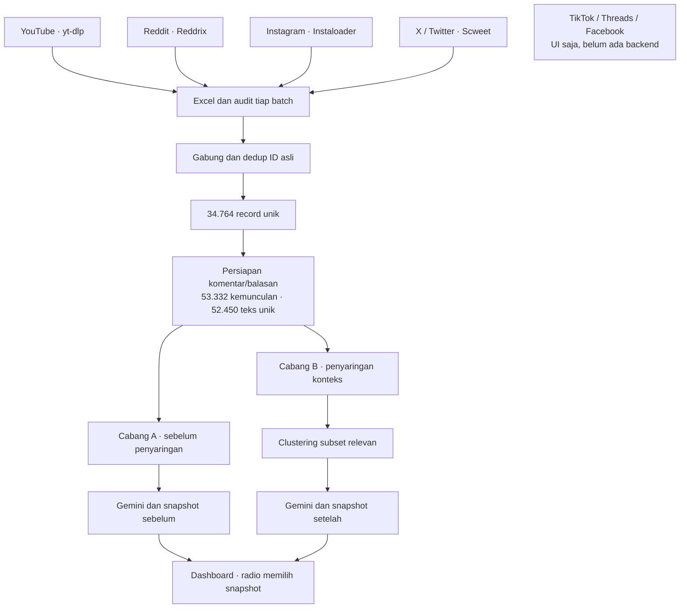
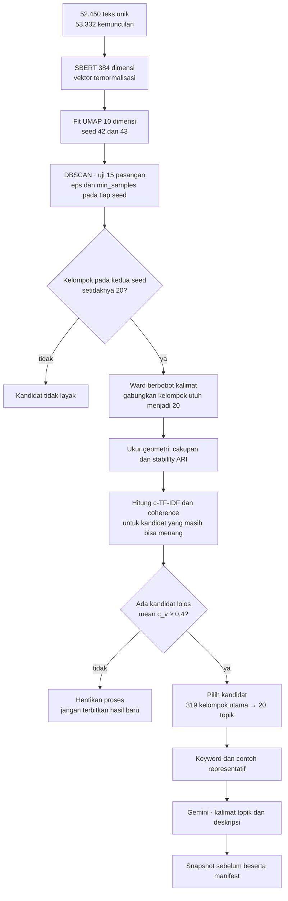
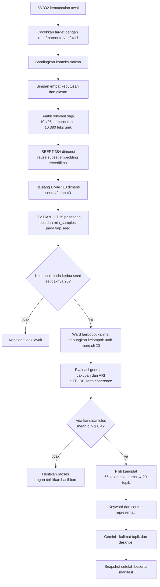

# Alur clustering sebelum dan setelah penyaringan

## Snapshot aktif — 5 November 2026

Gabungan lima platform termasuk TikTok: **36.233 record unik**, nol duplikat native ID.
Model sebelum/sesudah memiliki masing-masing **20 topik**, mean c_v **0,4346102845**
dan **0,4666033620**. Mask relevansi diulang dengan checksum sumber baru; 11.185
kemunculan/10.795 kalimat unik diterima. Pengguna menyetujui 40 narasi Google Gemini.
Pasangan aktif dipilih melalui config/dashboard.json; tidak ada API atau training
pada rerun UI. Runtime lokal sesi ini di http://127.0.0.1:8502; Docker daemon mati,
sehingga hasil verifikasi Docker sesi lama tidak berlaku untuk image baru.
Lihat [[Retraining Gabungan TikTok 20261105]]. Bagian bertanggal sebelumnya adalah riwayat.

Kedua hasil berangkat dari workbook yang sama. Perbedaannya ada pada kalimat yang diikutkan. Jalur sebelum penyaringan memakai seluruh kalimat yang memenuhi aturan persiapan dasar. Jalur setelah penyaringan hanya memakai kemunculan kalimat yang dinilai relevan dengan konteks pendidikan.

Di sini “training” berarti melakukan fit UMAP, DBSCAN, penggabungan kelompok, dan pemilihan parameter pada data. Bobot model SBERT tetap memakai model pralatih; tidak ada fine-tuning neural atau classifier yang dilatih dari label manusia.

[Buka floorplan](http://127.0.0.1:4378), lalu pilih **Flows → 04 · Clustering SEBELUM penyaringan** atau **05 · Clustering SETELAH penyaringan**. Alur 01 menunjukkan rangkaian lengkap sampai dashboard; alur 02 menampilkan ketujuh platform beserta status backendnya.

## Dari crawler ke pangkal dua jalur

`Crawler/Backend/social_crawler.py` mengoordinasikan YouTube lewat yt-dlp, Reddit lewat Reddrix, Instagram lewat Instaloader dengan patch permintaan web, dan X/Twitter lewat Scweet. TikTok, Threads, dan Facebook baru tersedia pada UI/simulasi, belum mempunyai adapter pengambilan Python. Layar React belum mengendalikan proses CLI ini.

`Crawler/Backend/social_export.py` dan kontrak ekspor yang dipakai adapter menghasilkan Excel serta audit sumber. `scripts/merge_social_datasets.py` menggabungkan batch berdasarkan platform, jenis record, dan ID asli. Teks identik dari dua ID berbeda tetap disimpan. Pemilihan observasi terbaru tidak menghapus hubungan asalnya.

Workbook aktif adalah `outputs/social_20261102_combined_twitter_01/social_data.xlsx`: **34.764 record unik**, terdiri dari 2.526 post akar dan 32.238 komentar/balasan, dari empat platform. Pemeriksaan sebelumnya menemukan nol ID ganda. Berkas sumber lengkap dipertahankan pada kedua snapshot NLP.

`SocialNLPClusterer.prepare_excel()` pada `MachineLearning/social_nlp.py` memilih komentar/balasan, memecah teks menjadi kalimat, memeriksa minimal dua kata dan delapan karakter, serta mencatat posisi teks dan ID asal. Hasil persiapan berisi **53.332 kemunculan kalimat** dan **52.450 teks unik**. Ini bukan jumlah post. Satu teks bisa muncul pada beberapa komentar; fitur teks dihitung sekali tetapi setiap kemunculan tetap terlacak.

Garis menyatakan perpindahan data. Operator masih menjalankan crawling, penggabungan, penyaringan, training dan publikasi lewat perintah terpisah. Tidak ada pemicu otomatis dari UI ke seluruh rangkaian.

## Cabang A: sebelum penyaringan

Preset: `config/social_nlp_twitter_20261102.json`, tanpa `relevance_artifact`.

Hasil terpilih memakai `eps=0.20`, `min_samples=5`. Proyeksi utama menghasilkan 319 kelompok awal; proyeksi alternatif menghasilkan 328. Sesudah penggabungan menjadi 20 topik, mean c_v adalah **0,4243209772**, cakupan teks unik **93,09%**, silhouette cosine **−0,02236**, dan stability ARI **0,79397**. Sebanyak 3.626 teks unik atau 3.677 kemunculan tetap menjadi noise. Sembilan topik individual masih mempunyai c_v di bawah 0,4.

Hasil tersimpan di `outputs/nlp_20261102_twitter_topics20_gemini_01/`.

## Cabang B: penyaringan, lalu clustering ulang

`scripts/filter_context_relevance.py` memakai `ContextRelevanceFilter` pada `MachineLearning/context_relevance.py` dan `LocalSemanticBackend` pada `MachineLearning/relevance_semantic.py`. Kalimat target dibandingkan dengan profil makna pendidikan, interaksi umum, serta pembahasan luar lingkup. Keyword pencarian tetap menjadi acuan lingkup: kuliah, kampus, universitas, beasiswa, dan jurusan.

`MachineLearning/source_roots.py` dan `build_units()` mencocokkan akar percakapan serta balasan induk dengan ID dan audit terverifikasi. Konteks ini hanya membantu kasus ambigu; kalimat jelas umum atau di luar lingkup tidak otomatis lolos hanya karena post induknya membahas pendidikan. Fitur clustering tetap berasal dari kalimat target, bukan gabungan teks parent.

| Keputusan | Kemunculan kalimat | Dipakai clustering |
|---|---:|---|
| Relevan | 10.496 | Ya |
| Interaksi umum | 18.990 | Tidak |
| Luar lingkup | 3.747 | Tidak |
| Belum pasti | 20.099 | Tidak |

Keputusan dan alasannya disimpan di `outputs/relevance_20261102_01/`. Jumlah yang tidak diteruskan adalah 42.836 kemunculan. Data sumber tetap utuh. Ambang kemiripan belum dikalibrasi dengan label manusia; skor bukan probabilitas atau akurasi.

Preset aktif: `config/social_nlp_relevance_20261102.json`, juga dipakai oleh `config/social_nlp.json`. `relevance_artifact` menunjuk audit di atas. `_apply_context_relevance()` memasang mask sesudah persiapan dan sebelum encoding, dengan pemeriksaan kecocokan sumber dan kalimat.

Hasil ini memakai subset embedding baseline yang sudah diperiksa terhadap source SHA, revision model, pengaturan jendela, ID, teks, dimensi, serta nilai vektor. Reuse ini menghemat encoding. **UMAP, DBSCAN, Ward, dan evaluasinya tetap dihitung ulang** pada korpus tersaring.

Hasil terpilih memakai `eps=0.25`, `min_samples=10`, dengan 66 kelompok awal pada masing-masing seed sebelum digabung menjadi 20 topik. Mean c_v **0,4733391691**, cakupan teks unik **82,17%**, silhouette cosine **0,04965**, dan stability ARI **0,81181**. Sebanyak 1.851 teks unik atau 1.872 kemunculan tetap menjadi noise; 8.624 kemunculan mendapat topik. Tujuh topik individual masih mempunyai c_v di bawah 0,4.

Hasil tersimpan di `outputs/nlp_20261102_relevance_topics20_gemini_02/`. Penambahan Gemini pada bundle ini tidak mengubah hasil fit dari `outputs/nlp_20261102_relevance_topics20_01/`.

## Apa yang sama pada kedua jalur

`SocialNLPClusterer.fit_excel()` menjalankan `prepare_excel() → encode() → compare() → describe_topics()`. `compare()` mencakup reduksi UMAP, grid DBSCAN, penggabungan Ward dan seleksi kandidat. Penyimpanan serta narasi dijalankan sesudah hasil tersedia.

Encoder adalah `sentence-transformers/paraphrase-multilingual-MiniLM-L12-v2`, revision `e8f8c211226b894fcb81acc59f3b34ba3efd5f42`. Jendela panjang 128 token memakai stride 24; rata-rata embedding jendela dinormalisasi L2. UMAP menggunakan `n_neighbors=15`, `n_components=10`, `min_dist=0`, metric cosine. DBSCAN memakai jarak Euclidean pada hasil UMAP; silhouette dievaluasi dengan cosine pada SBERT asli.

Grid DBSCAN berisi `eps=[0.10,0.15,0.20,0.25,0.30]` dan `min_samples=[3,5,10]`. Untuk setiap kandidat yang cukup kelompok pada kedua seed, `_merge_topics()` menggabungkan kelompok utuh memakai Ward berbobot jumlah kalimat di ruang SBERT asli. Noise tidak dimasukkan dan kelompok tidak dibelah. Jadi “20 topik” bukan berarti DBSCAN selalu langsung menemukan 20.

Pemilihan menggunakan cakupan minimal 0,4, proporsi kelompok terbesar maksimal 0,5, serta skor gabungan `0.60*max(silhouette,0)*coverage + 0.25*max(ARI,0) + 0.15*coverage`. Toleransi skor 0,005. Kandidat diperiksa menurut skor; coherence dihitung untuk kandidat yang masih bisa menang dalam rentang kandidat lolos terbaik. Kandidat lain ditandai tidak dievaluasi coherence, bukan dianggap lolos.

`_ctfidf_terms()` memberi peringkat istilah per kelompok. `score_coherence()` memakai Gensim c_v, top 10 istilah, window 110, dan seluruh teks unik pada korpus jalur tersebut termasuk noise. **Gate 0,4 berlaku pada rata-rata seluruh 20 topik**, bukan pada setiap topik. Jika tidak ada kandidat lolos, proses berhenti dan tidak memublikasikan hasil baru. c_v merupakan ukuran keselarasan leksikal dalam korpus, bukan akurasi label atau pengujian generalisasi pada data terpisah.

## Dari 20 topik ke dashboard

`MachineLearning/topic_narratives.py` menerima sepuluh keyword c-TF-IDF berbobot positif dan sampai sepuluh kalimat representatif terdekat centroid per topik. Gemini menghasilkan satu kalimat topik dan paragraf penjelasan, disimpan dalam `topic_narratives.csv`. Pada kedua snapshot ini tersedia 20 baris narasi. Gemini tidak memilih anggota cluster dan tidak menambah skor coherence.

`save()` menulis bundle baru dengan `sentences.parquet`, `occurrences.parquet`, `social_data.parquet`, `topics.json`, `summary.json`, array model dan `manifest.json`; bundle tersaring juga mempunyai audit relevansi. `scripts/generate_topic_narratives.py` dapat membuat bundle turunan bernarasi tanpa melakukan fit ulang. Model lama tidak ditimpa.

`config/dashboard.json` menetapkan path `before` dan `after`. `streamlit_apps.py` membuka `Dashboard/app.py`; radio **Sebelum penyaringan / Setelah penyaringan** memuat bundle yang dipilih. Ringkasan, peta topik, penjelasan Gemini, kalimat sumber, serta metode mengikuti snapshot tersebut. Rerun dashboard tidak memulai crawling, training, clustering atau API Gemini.

| Pembandingan hasil tersimpan | Sebelum | Setelah |
|---|---:|---:|
| Record sumber unik | 34.764 | 34.764 |
| Kemunculan kalimat masukan | 53.332 | 10.496 |
| Teks unik masukan | 52.450 | 10.380 |
| Kelompok DBSCAN utama | 319 | 66 |
| Topik final | 20 | 20 |
| Rata-rata c_v | 0,4243 | 0,4733 |
| Topik individual di bawah 0,4 | 9 | 7 |
| Narasi Gemini | 20 | 20 |

Korpus dan model fit berbeda, sehingga nomor topik antarhasil tidak otomatis sepadan. Selisih coherence juga tidak membuktikan akurasi naik. Bandingkan tema, keyword, kutipan sumber, keputusan penyaringan, noise dan cakupannya bersama-sama.

Pembaruan peta ini hanya mendokumentasikan kode dan hasil terverifikasi yang sudah ada. Tidak ada crawling, training, atau panggilan Gemini baru.

[[Peta Cara Kerja BeeSense]] · [[Relevansi Konteks 20261102]] · [[Arsitektur BeeSense]] · [[HOME]]
