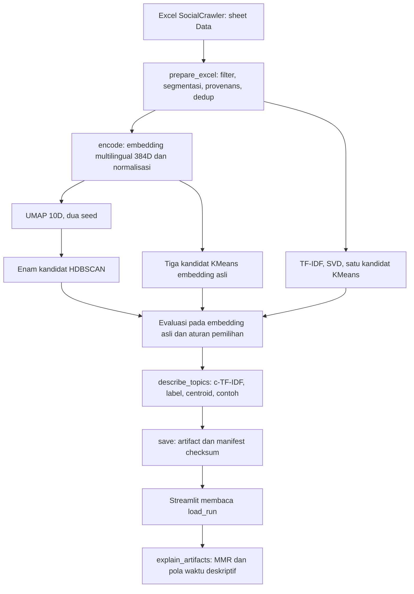

# Metodologi Machine Learning Social NLP

Dokumen ini menjelaskan implementasi aktual [social_nlp.py](../../social_nlp.py), konfigurasi [social_nlp.json](../../social_nlp.json), artifact [run aktif](../../outputs/nlp_20261028_02/summary.json), dan [pengujian NLP](../../tests/nlp). Angka hasil berasal dari snapshot yang disertakan; uraian teori diberi referensi primer. Pilihan desain atau batas implementasi dinyatakan terpisah dari hasil pengukuran.

`SocialNLPClusterer` adalah pipeline **unsupervised sentence clustering** untuk mencari kelompok pembicaraan. Encoder multilingual pralatih dipakai dalam keadaan tetap. Program melakukan fitting UMAP, clustering dan representasi leksikal pada korpus lokal; program tidak melatih ulang bobot Transformer. Dashboard hanya membaca hasil tersimpan dan menghitung penjelasan deskriptif.

## Daftar isi

1. [Tujuan dan batas masalah](#1-tujuan-dan-batas-masalah)
2. [Arsitektur dan alur fungsi](#2-arsitektur-dan-alur-fungsi)
3. [Dataset dan unit analisis](#3-dataset-dan-unit-analisis)
4. [Preparasi dan segmentasi kalimat](#4-preparasi-dan-segmentasi-kalimat)
5. [Embedding dan cache](#5-embedding-dan-cache)
6. [Kandidat algoritma dan fitting](#6-kandidat-algoritma-dan-fitting)
7. [Evaluasi dan pemilihan algoritma](#7-evaluasi-dan-pemilihan-algoritma)
8. [Topic extraction c-TF-IDF](#8-topic-extraction-c-tf-idf)
9. [Graf topik](#9-graf-topik)
10. [Penjelasan dan tren topik](#10-penjelasan-dan-tren-topik)
11. [Seluruh konfigurasi dan hyperparameter](#11-seluruh-konfigurasi-dan-hyperparameter)
12. [Apa yang dimaksud training](#12-apa-yang-dimaksud-training)
13. [Penyimpanan dan reproduksibilitas](#13-penyimpanan-dan-reproduksibilitas)
14. [Testing dan validasi](#14-testing-dan-validasi)
15. [Interpretasi dan pengembangan metodologi](#15-interpretasi-dan-pengembangan-metodologi)
16. [Peta kode dan referensi](#16-peta-kode-dan-referensi)

## 1. Tujuan dan batas masalah

Inputnya percakapan pendek, informal dan campuran bahasa dari YouTube/Reddit. Satu komentar dapat membicarakan beberapa hal, sehingga unit pembentukan cluster adalah kalimat/segmen informatif. Setiap kalimat unik mendapatkan satu cluster atau label noise `-1`. Satu komentar dapat mempunyai beberapa topik melalui kalimat-kalimatnya; ini berbeda dari model distribusi probabilitas banyak topik untuk setiap kalimat.

Hasil yang dicari meliputi kelompok kalimat, istilah pembeda, contoh yang dapat ditelusuri, kedekatan antar kelompok, dan pola porsi komentar dalam snapshot. Tidak ada label target, klasifikasi sentimen, diagnosis, inferensi identitas/peran penulis, prediksi tren, atau pembuktian hubungan sebab-akibat.

Pola besarnya mirip keluarga BERTopic: embedding → reduksi dimensi → clustering → c-TF-IDF. Implementasi modular ini **tidak memakai paket BERTopic** dan tidak identik dengan seluruh default/prosedur BERTopic. Alasan modular: mempertahankan provenans setiap kalimat, membandingkan kandidat dalam metrik yang sama, dan memisahkan komputasi ML dari UI. [Rujukan pola BERTopic](https://maartengr.github.io/BERTopic/algorithm/algorithm.html).

## 2. Arsitektur dan alur fungsi



Rantai [fit_excel](../../social_nlp.py#L1737) adalah:

```python
self.prepare_excel(path).encode().compare().describe_topics()
```

`save()` dipanggil terpisah; `explain_topics()` bukan tahap otomatis dalam `fit_excel()`. UI berada di class `SocialNLPStreamlitApp` pada nlp_dashboard.py, bukan di class ML.

| Fungsi | Tanggung jawab |
|---|---|
| `__init__`, `_validate_config` | Muat JSON dasar, gabungkan override yang dikenal, validasi pengaturan |
| `sentence_spans`, `_clean`, `prepare_excel` | Bentuk dua tabel kalimat unik dan kemunculan, serta daftar segmen terlewat |
| `_encode_onnx`, `encode` | Inference encoder tetap, pooling, normalisasi dan cache |
| `compare`, `_evaluate`, `stability`, `select_candidate` | Fit kandidat, ukur, kemudian pilih dengan aturan eksplisit |
| `describe_topics`, `build_topic_graph` | Ekstraksi istilah, label, contoh dan kedekatan topik |
| `explain_topics`, `explain_artifacts` | Penjelasan dari objek terfit atau artifact yang sudah dimuat |
| `save`, `load_run` | Publikasi atomik dan pemuatan snapshot |
| `save_explanations`, `load_explanations` | Sidecar penjelasan opsional, terpisah dari run asli |

Constructor menerima path JSON atau dictionary override, `encoder` opsional untuk tes, serta callback `progress`. `_event()` menyampaikan tahap prepared, embedding, encoded, reducing, candidate, selected dan saved. Override dictionary bertingkat digabung satu tingkat pada blok konfigurasi; field yang tidak dikenal ditolak.

## 3. Dataset dan unit analisis

Data bawaan berada pada [social_data.xlsx](../../outputs/social_20261028_01/social_data.xlsx), hasilnya pada [nlp_20261028_02](../../outputs/nlp_20261028_02/summary.json).

| Ukuran snapshot | Nilai |
|---|---:|
| Baris input Excel | 8.449 |
| Baris berjenis komentar/balasan | 8.218 |
| Komentar/balasan yang menyumbang kalimat | 7.944 |
| Kemunculan kalimat informatif | 16.178 |
| Kalimat unik untuk fitting | 15.878 |
| Kemunculan duplikat | 300 |
| Segmen terlewat | 1.045 |
| Cluster terpilih | 51 |
| Kalimat unik tercluster | 8.427 |
| Kalimat unik noise | 7.451 |
| Kemunculan tercluster / noise | 8.628 / 7.550 |
| Bentuk matriks embedding / centroid | 15.878 × 384 / 51 × 384 |

Tiga unit tidak boleh dipertukarkan:

- **Kalimat unik:** satu teks embedding setelah pembersihan; satu suara dalam fitting dan c-TF-IDF.
- **Kemunculan:** setiap lokasi kalimat pada komentar sumber. Kalimat identik di dua komentar tetap memiliki dua occurrence.
- **Komentar terwakili:** baris sumber yang menyumbang sedikitnya satu kalimat; untuk tren diidentifikasi oleh platform + source_row.

Karena dedup, frasa yang berulang pada banyak komentar tidak memperbesar bobot geometris dalam fitting. Frekuensi aslinya tetap terlihat pada hitungan occurrence. Ini pilihan desain untuk mengurangi dominasi pengulangan, bukan deteksi spam/bot yang tervalidasi.

Default `include_kinds=["comment","reply"]`: judul video/post disimpan sebagai konteks, tetapi tidak digabung ke fitur teks. Tanggal dan platform juga bukan fitur. Pergantian JSON yang memuat post/video akan mengubah definisi populasi fitting dan sebaiknya didokumentasikan pada run baru.

## 4. Preparasi dan segmentasi kalimat

Sumber implementasi: [sentence_spans](../../social_nlp.py#L168), [_clean](../../social_nlp.py#L215), [prepare_excel](../../social_nlp.py#L220).

### 4.1 Membaca dan memvalidasi sumber

Program menghitung SHA-256 Excel, membaca workbook secara read-only/data-only, mewajibkan sheet `Data`, dan memeriksa sepuluh kolom SocialCrawler. `source_row` menggunakan nomor baris Excel sebenarnya, dimulai dari 2 karena baris pertama header.

Setelah jenis konten diseleksi, `teks_dipotong` yang bernilai benar menghentikan preparasi. Program tidak berpura-pura mempelajari teks lengkap dari input yang sudah terpotong. Teks kosong dicatat dengan alasan `empty_text`; potongan yang kurang informatif menggunakan `too_short_or_nonlinguistic`.

### 4.2 Segmentasi berbasis aturan

Pemisah utama adalah tanda akhir kalimat `. ! ?` yang diikuti batas whitespace/akhir teks, atau newline. Sebelum mencari batas, program melindungi tanda pada URL, email, angka desimal, serta singkatan seperti Prof., dr., dll. Perlindungan memakai salinan teks; offset tetap menunjuk string asli.

Segmen melebihi 1.200 karakter dipecah menjadi jendela karakter. Program berusaha memotong pada spasi di separuh akhir jendela, menyimpan semua bagian, dan memberi label `length_window`. Ini bukan segmentasi linguistik sempurna: slang, tanda baca tidak baku dan konteks antar kalimat tetap menjadi keterbatasan.

Contoh aturan:

```text
Prof. Dian membayar 3.5 juta. Kuliah di UI?
```

Menghasilkan dua kalimat, bukan memotong pada titik setelah Prof atau titik desimal.

### 4.3 Dua versi teks dan identitas

`sentence` mempertahankan kutipan asli. `embedding_text` hanya menerima normalisasi Unicode NFC, penghapusan URL, pemadatan whitespace dan trim. **Tidak ada stemming, lemmatisasi, terjemahan, ekspansi slang, lowercase, atau penghapusan stopword pada input embedding.** Negasi pada teks embedding tetap ada.

Untuk kelayakan segmen, teks bersih harus memenuhi minimum 8 karakter dan 2 kata linguistik menurut regex. Angka/emoji saja tidak menjadi bukti bahasa yang cukup. Batas maksimal 100.000 kalimat unik adalah batas anggaran: jika terlampaui, program berhenti dan tidak melakukan sampling diam-diam. Minimal 12 kalimat unik diperlukan untuk melanjutkan.

```text
sentence_id   = SHA256(embedding_text)[:24]
occurrence_id = SHA256(input_hash:source_row:span_start:span_end)[:24]
```

Dedup bersifat case-sensitive karena `_clean()` tidak menurunkan huruf. Perbedaan URL dapat hilang dari embedding_text, tetapi kutipan dan URL sumber occurrence tetap tersimpan. Benturan hash ID dengan teks berbeda ditolak.

`occurrences` menyimpan span_start/end, sumber/platform/jenis, judul/URL, tanggal post/konten dan tingkat kepastiannya. Tanggal hanya diubah ke ISO jika nilai sumber mendukung isoformat; teks usia yang tidak sudah menjadi tanggal tidak diubah menjadi timestamp buatan pada tahap ini.

## 5. Embedding dan cache

Sumber: [_encode_onnx](../../social_nlp.py#L346) dan [encode](../../social_nlp.py#L449).

### 5.1 Encoder yang digunakan

Model `sentence-transformers/paraphrase-multilingual-MiniLM-L12-v2` menyediakan representasi multilingual 384 dimensi. Model card menjelaskan pemakaian untuk kemiripan kalimat. Proyek memakainya secara lokal melalui file ONNX quantized AVX2 dan CPUExecutionProvider, bukan layanan embedding jarak jauh. [Model card resmi](https://huggingface.co/sentence-transformers/paraphrase-multilingual-MiniLM-L12-v2).

Revision dikunci ke `e8f8c211226b894fcb81acc59f3b34ba3efd5f42`. File model, tokenizer.json dan config.json diunduh melalui Hugging Face ketika encoding baru membutuhkan file tersebut. `token=False` tidak meminta token akun. Bobot encoder tidak di-update oleh data BeeSense; SHA-256 bobot dan tokenizer dicatat pada metadata.

### 5.2 Tokenisasi dan jendela panjang

Batas tokenizer 128 token dengan overlap/stride 24. Setiap encoding dan seluruh overflow window diproses. Per batch dibuat input_ids, attention_mask dan token_type_ids; padding menggunakan pad_token_id model. Hanya nama input yang didukung signature ONNX dikirim. Keluaran harus berbentuk embedding token tiga dimensi.

Ada dua batas berbeda: **1.200 karakter** untuk segmentasi sumber dan **128 token** untuk jendela encoder. Segmentasi karakter tidak menjamin sebuah segmen muat satu window tokenizer. Snapshot mencatat 20 kalimat unik yang membutuhkan lebih dari satu window; ini bukan berarti total window hanya 20.

### 5.3 Pooling dan normalisasi

Untuk window berisi token embedding h dan mask m:

$$
v_w = \frac{\sum_t m_t h_t}{\max(\sum_t m_t,1)}
$$

Padding tidak masuk rata-rata. Seluruh vektor window milik satu kalimat dirata-ratakan dengan **bobot sama antar window**, lalu hasilnya dinormalisasi L2:

$$
x_i = \frac{\operatorname{mean}_w(v_w)}{\|\operatorname{mean}_w(v_w)\|_2}
$$

Overlap dapat membuat sebagian token berpengaruh di beberapa window; window akhir yang pendek juga memperoleh bobot window yang sama. Jadi ini bukan rata-rata satu kali atas setiap token unik dalam keseluruhan kalimat. Matriks akhir float32 harus dua dimensi, mempunyai jumlah baris yang benar, berisi nilai finite dan tidak memiliki vektor nol.

Untuk vektor yang sudah bernorma satu, dot product dua vektor adalah cosine similarity. Ini dipakai untuk centroid, bukti MMR dan graf; tidak berarti semua algoritma fitting memakai objective cosine.

### 5.4 Cache

Kunci cache mengikat konfigurasi model, urutan seluruh embedding_text, dan VERSION kode. Cache NPY hanya digunakan jika metadata JSON ada dan checksum NPY cocok. Pemuatan memakai allow_pickle=False. Cache yang valid mempertahankan model_info dan window_counts; jika norma sudah mendekati satu, normalisasi ulang dihindari.

Perubahan teks/urutan, revision, opsi model atau versi kode menghasilkan kunci baru. Karena seluruh blok model masuk kunci, perubahan batch_size/threads juga membuat kunci berbeda. Cache model/embedding tidak dipublikasikan; dashboard dapat berjalan dari embedding dalam run tersimpan tanpa cache tersebut.

## 6. Kandidat algoritma dan fitting

Sumber: [compare](../../social_nlp.py#L605). Fitting memakai seluruh kalimat unik yang lolos preparasi. Tidak ada pembagian train/test, label manual, cross-validation atau early stopping untuk memilih kandidat saat ini.

### 6.1 HDBSCAN pada UMAP

UMAP mengubah embedding 384D menjadi representasi 10D. Konfigurasi eksplisit: n_neighbors=15, min_dist=0, metric=cosine, random_state=42 dan 43, n_jobs=1. Pada dataset kecil, neighbors dibatasi n−1 dan dimensi n−2.

Secara umum, n_neighbors menentukan skala struktur tetangga yang dipertahankan dan min_dist mengatur seberapa rapat representasi rendah dimensi dapat tersusun. Pemilihan 10D dimaksudkan untuk clustering, bukan diagram koordinat dua dimensi. UMAP dapat mengubah geometri/kepadatan, sehingga hasil tetap dievaluasi pada embedding asli. [Dokumentasi parameter UMAP](https://umap-learn.readthedocs.io/en/latest/parameters.html).

HDBSCAN mencari kelompok berdasarkan struktur kepadatan dan dapat menolak titik sebagai noise. K dipilih dari struktur data, bukan ditetapkan sebelumnya. Proyek memakai implementasi **scikit-learn**, metric=euclidean pada ruang UMAP, pemilihan cluster eom, n_jobs=1, copy=True. Pada implementasi ini min_samples menghitung titik itu sendiri; angka tidak boleh dipindahkan begitu saja ke paket hdbscan-contrib. [Dokumentasi HDBSCAN](https://scikit-learn.org/stable/modules/generated/sklearn.cluster.HDBSCAN.html).

Grid yang dicoba adalah:

```text
min_cluster_size ∈ {15, 30, 60}
min_samples      ∈ {5, 10}
```

Masing-masing dari enam kombinasi di-fit pada dua hasil UMAP. Partisi seed 42 menjadi calon hasil; partisi seed 43 dipakai untuk menilai stabilitas. Keduanya tidak di-ensemble. Nilai min_cluster_size yang lebih besar menaikkan minimum dukungan suatu kelompok; min_samples yang lebih konservatif dapat meningkatkan penolakan sebagai noise. Arah perubahan jumlah cluster/coverage tidak dijamin monoton untuk setiap dataset.

Probabilities_ dari kandidat HDBSCAN terpilih disimpan sebagai membership_strength. Itu kekuatan keanggotaan model, bukan akurasi label atau confidence tren yang terkalibrasi.

### 6.2 KMeans semantik

Tiga kandidat K=40, 80 dan 120 di-fit langsung pada embedding asli 384D, masing-masing dengan seed 42/43 dan n_init=10. Tidak memakai hasil UMAP. Keuntungannya sederhana, cepat untuk baseline centroid, dan seluruh titik mendapat cluster. Kekurangannya perlu K serta memaksa kalimat yang ambigu/noisy masuk kelompok.

KMeans biasa mengoptimalkan jumlah squared Euclidean distance terhadap centroid. Walau input dinormalisasi, implementasi ini tidak dinyatakan sebagai spherical KMeans karena centroid tidak dipaksa bernorma satu selama fitting. [Dokumentasi KMeans](https://scikit-learn.org/stable/modules/generated/sklearn.cluster.KMeans.html).

### 6.3 Baseline leksikal TF-IDF → SVD → KMeans

TfidfVectorizer memakai unigram/bigram, min_df=2, max_df=0,95, maksimal 25.000 fitur, stopword Indonesia/Inggris dan sublinear_tf=True. TruncatedSVD menghasilkan min(100, jumlah_fitur−1, n−1) dimensi; hasilnya dinormalisasi L2 sebelum KMeans K=80. Jika dimensi yang tersedia kurang dari dua, kandidat baseline ini tidak dibentuk.

SVD di-fit sekali dengan seed 42; dua KMeans memakai seed 42/43. Karena SVD tetap, stabilitas baseline hanya menguji perubahan seed KMeans, bukan seluruh ketidakpastian reduksi leksikal. Baseline mengukur alternatif yang berfokus pada kemiripan kata, sehingga dapat berbeda dari paraphrase semantik.

### 6.4 Besarnya pencarian

Untuk snapshot ini seluruh kandidat memenuhi batas ukuran data: 6 HDBSCAN + 3 KMeans semantik + 1 baseline leksikal = **10 kandidat**. Untuk mengukur stabilitas, itu berarti 20 fitting clustering, ditambah dua UMAP dan satu SVD. Delapan fitting KMeans masing-masing memakai 10 inisialisasi; angka 10 kandidat bukan 10 update neural network.

Kandidat HDBSCAN dengan size≥n dan kandidat KMeans semantik dengan K≥n dilewati. K baseline dibatasi n−1. Jumlah kandidat pada korpus kecil atau konfigurasi lain dapat berbeda. Threadpool numerik dibatasi model.threads, sementara UMAP/HDBSCAN menjalankan n_jobs=1.

## 7. Evaluasi dan pemilihan algoritma

Sumber: [_evaluate](../../social_nlp.py#L553), [stability](../../social_nlp.py#L515), [select_candidate](../../social_nlp.py#L528).

### 7.1 Coverage dan ukuran kelompok terbesar

$$
coverage = \frac{N_{assigned}}{N_{unique}},\qquad
largest = \frac{\max_c N_c}{N_{assigned}}
$$

Penyebut largest adalah kalimat **assigned**, bukan seluruh korpus. Kandidat eligible jika mempunyai sedikitnya dua cluster, silhouette dapat dihitung, coverage≥0,40, dan largest≤0,50. Silhouette negatif tidak otomatis membuat kandidat tidak eligible.

### 7.2 Silhouette cosine pada ruang yang sama

Satu sampel acak tetap sebanyak min(n,1800) dipilih tanpa penggantian, lalu diurutkan. Untuk setiap kandidat, hanya anggota sampel yang assigned dipakai. Semua kandidat, termasuk baseline leksikal, dievaluasi dengan cosine distance pada **embedding asli 384D**; bukan koordinat UMAP/SVD atau posisi graf.

Silhouette setiap titik secara umum adalah `(b−a)/max(a,b)`, dengan a jarak dalam cluster dan b jarak rata-rata terdekat ke cluster lain. Nilai lebih tinggi menandakan pemisahan geometris yang lebih kuat pada ruang yang diukur. Ini bukan persentase kalimat yang maknanya benar. [Definisi silhouette](https://scikit-learn.org/stable/modules/generated/sklearn.metrics.silhouette_score.html).

Sampel HDBSCAN terpilih hanya menyisakan 939 assigned dari 1.800, sedangkan KMeans menggunakan 1.800. Perbedaan himpunan pengukuran ini tetap ada meskipun indeks awal sama; penalti coverage pada skor mengurangi keuntungan menolak banyak titik, tetapi tidak menjadikan perbandingan benar-benar tanpa bias.

### 7.3 Stabilitas ARI dan penanganan noise

ARI membandingkan dua partisi tanpa mensyaratkan nomor cluster sama. Program mengambil union titik yang assigned pada sedikitnya satu partisi. Titik noise di kedua partisi dikeluarkan. Noise yang masih ada pada satu partisi diubah menjadi singleton berbeda untuk setiap indeks, sehingga kumpulan noise tidak dianggap satu cluster koheren. Union kurang dari delapan titik menghasilkan stabilitas 0. [Dokumentasi ARI](https://scikit-learn.org/stable/modules/generated/sklearn.metrics.adjusted_rand_score.html).

ARI ini mengukur kesepakatan antar seed, bukan kesesuaian terhadap anotasi kebenaran, ketahanan terhadap periode/platform baru, atau bootstrap populasi. Perbedaan yang diganggu juga berbeda: UMAP untuk HDBSCAN, inisialisasi KMeans untuk kandidat centroid.

### 7.4 Skor gabungan dan toleransi

Bagi kandidat eligible:

$$
S = 0.60\max(silhouette,0)\,coverage
  + 0.25\max(ARI,0)
  + 0.15\,coverage
$$

Kandidat yang gagal gate mendapat skor None. Silhouette negatif dipotong menjadi nol dalam komponen skor, tetapi nilainya tetap dicatat. Bobot ini pilihan operasional proyek; tidak berasal dari pembuktian statistik universal.

Pemilihan dilakukan dua tahap:

1. Temukan S tertinggi pada kandidat eligible; ambil semua kandidat dengan `S ≥ S_max − score_tolerance`.
2. Dalam kelompok tersebut, pilih secara leksikografis: silhouette tertinggi, lalu ARI, lalu coverage.

Default tolerance=0,005 memberi prioritas pemisahan semantik ketika skor dianggap berdekatan. Jika tolerance=0, hanya kandidat dengan skor tertinggi yang lolos tahap pertama. Aturan tidak meng-hardcode nama HDBSCAN.

### 7.5 Hasil seluruh kandidat pada data asli

Sumber: [comparison.json](../../outputs/nlp_20261028_02/comparison.json). Angka dibulatkan untuk tabel; semua sepuluh kandidat eligible. Coverage berdasarkan kalimat unik, bukan occurrence.

| Kandidat | Cluster | Coverage | Silhouette | ARI | Skor S |
|---|---:|---:|---:|---:|---:|
| HDBSCAN m15 s5 | 179 | 60,27% | 0,023174 | 0,671352 | 0,266616 |
| HDBSCAN m15 s10 | 153 | 56,76% | 0,039263 | 0,687133 | 0,270302 |
| HDBSCAN m30 s5 | 103 | 60,32% | 0,064061 | 0,683084 | 0,284429 |
| HDBSCAN m30 s10 | 93 | 56,29% | 0,045247 | 0,818162 | 0,304249 |
| HDBSCAN m60 s5 | 51 | 56,92% | 0,091010 | 0,692030 | 0,289460 |
| **HDBSCAN m60 s10: terpilih** | **51** | **53,07%** | **0,095095** | **0,805997** | **0,311392** |
| **KMeans K40: skor S tertinggi** | **40** | **100%** | **0,033306** | **0,565857** | **0,311448** |
| KMeans K80 | 80 | 100% | 0,031869 | 0,440604 | 0,279273 |
| KMeans K120 | 120 | 100% | 0,027187 | 0,441274 | 0,276631 |
| TF-IDF/SVD/KMeans K80 | 80 | 100% | −0,139951 | 0,500574 | 0,275144 |

Selisih dua skor teratas hanya sekitar 0,0000562, lebih kecil dari toleransi 0,005. Karena silhouette HDBSCAN lebih tinggi, aturan memilih HDBSCAN m60 s10. Ini tradeoff: pemisahan/stabilitas lebih baik pada metrik internal, dengan 46,93% kalimat unik menjadi noise.

Kesimpulan yang didukung adalah **kandidat terpilih menurut aturan proyek pada snapshot ini**. Belum ada dasar untuk menyebut HDBSCAN paling akurat secara semantik atau terbaik pada semua dataset. Evaluasi leksikal dalam ruang encoder yang juga menjadi fitur kandidat semantik memiliki keberpihakan representasi; penilaian manusia tetap diperlukan.

## 8. Topic extraction c-TF-IDF

Sumber: [describe_topics](../../social_nlp.py#L736). Clustering menentukan anggota; c-TF-IDF menentukan **bagaimana kelompok itu diberi representasi kata**. Tahap ini tidak mengubah keanggotaan cluster.

### 8.1 Membentuk vocabulary

CountVectorizer di-fit pada seluruh embedding_text kalimat unik, termasuk kalimat noise. Parameternya unigram/bigram, min_df=2, max_df=0,95, maksimal 25.000 fitur, stopword Indonesia ditambah ENGLISH_STOP_WORDS, dan token minimal dua karakter yang dimulai huruf. Lowercase mengikuti default vectorizer.

Dengan demikian, min_df=2 berarti muncul di sedikitnya dua **kalimat unik**, bukan dua cluster atau dua occurrence. Duplikasi komentar tidak menaikkan document frequency setelah dedup. Stopword hanya diterapkan pada jalur leksikal; embedding tetap memakai teks dengan negasi. Daftar stopword Indonesia memuat beberapa bentuk seperti ga/gak/tak, sehingga bentuk negasi tersebut dapat hilang dari label leksikal walau tetap ada pada fitur embedding.

### 8.2 Agregasi kelas dan pembobotan

Hanya label cluster nonnegatif dibuat sebagai kelas; noise tidak menjadi satu topik. Matriks pemetaan sparse menjumlahkan bag-of-words semua kalimat unik dalam setiap cluster. Bukan konkatenasi mentah kalimat menjadi satu string: bigram tidak diciptakan melintasi batas dua kalimat terpisah.

Dengan C(c,t) sebagai hitungan term t dalam cluster c:

$$
TF(c,t)=\frac{C(c,t)}{\sum_j C(c,j)}
$$

$$
A=\operatorname{mean}_c\sum_t C(c,t),\quad
IDF(t)=\log\left(1+\frac{A}{\max(\sum_c C(c,t),1)}\right)
$$

$$
cTFIDF(c,t)=TF(c,t)\,IDF(t)
$$

Ini menonjolkan term yang mewakili cluster relatif terhadap keseluruhan cluster. Vocabulary dipelajari pada semua kalimat, tetapi hitungan kelas/IDF di atas menjumlahkan kalimat assigned saja. Rumus dan tahap vectorizer harus dibaca sesuai kode; tidak semua konfigurasi BERTopic diterapkan. [Konsep c-TF-IDF](https://maartengr.github.io/BERTopic/getting_started/ctfidf/ctfidf.html).

### 8.3 Label dan contoh representatif

Program mengurutkan bobot c-TF-IDF dan mengambil maksimal 12 term. Dari daftar itu dipilih maksimal tiga frasa untuk label, dengan penyaringan subset/superset himpunan kata agar frasa yang terlalu saling memuat tidak diulang. Label digabung memakai ` / `.

Penyaringan ini berbasis token set, bukan model semantik atau peringkasan LLM. `terms` tidak menyimpan skor bobotnya. Tidak ada filter eksplisit bobot positif sebelum top-12, sehingga kelompok dengan sedikit vocabulary dapat menyertakan term berbobot nol di ekor daftar. Kata umum yang belum tercakup stopword juga dapat muncul; label perlu ditinjau manusia.

Untuk tiap cluster, centroid adalah rata-rata embedding asli anggota lalu dinormalisasi. `centroid_similarity` adalah dot product kalimat terhadap centroid tersebut. Lima kalimat unik terdekat disimpan dalam representative_ids. `unique_sentences`, `occurrences`, platform_counts dan mean_centroid_similarity menjelaskan ukuran/sumber dengan unit masing-masing.

Contoh output asli: T38 berlabel beasiswa/dapat/beasiswanya. Label ini menunjukkan istilah yang dipilih otomatis; bukan judul editorial yang membuktikan seluruh makna cluster. Member ID cluster adalah indeks lokal run dan tidak stabil sebagai identitas topik antar training ulang.

## 9. Graf topik

Sumber: [build_topic_graph](../../social_nlp.py#L815). Cosine similarity semua pasangan centroid asli dihitung. Untuk setiap topik, paling banyak tiga tetangga terdekat diperiksa dan yang skornya <0,55 dibuang. Pasangan simetris digabung menjadi satu edge.

Tiga tetangga per node saat penemuan tidak menjamin degree akhir setiap node≤3: node dapat dipilih oleh beberapa node lain. Semua topik tetap menjadi node, termasuk yang tanpa edge. Pada snapshot terdapat 51 node dan 80 edge.

Edge berstatus INFERRED, relation semantic_similarity, score_kind cosine_not_probability. Ia tidak menyatakan hubungan sosial, aliran balasan, kepastian label atau sebab-akibat. Peta posisi dua dimensi di dashboard adalah layout jaringan terpisah, bukan proyeksi UMAP 10D yang dipakai HDBSCAN.

`graph.max_nodes=180` saat ini divalidasi dalam konfigurasi tetapi **tidak dipakai sebagai pemotong node oleh build_topic_graph()**. Batas node yang ditampilkan UI ditentukan argumen/slider tampilan. Mengubah field ini saja tidak mengubah jumlah cluster atau memangkas graf tersimpan.

## 10. Penjelasan dan tren topik

Sumber: [explain_topics](../../social_nlp.py#L1350), [_explanation_evidence](../../social_nlp.py#L926), [_explanation_trend](../../social_nlp.py#L1075), [_explanation_term_changes](../../social_nlp.py#L1301). Rincian antarmuka juga ada pada [EXPLAINABLE_TOPICS.md](../../EXPLAINABLE_TOPICS.md).

### 10.1 Deskripsi ekstraktif dan MMR

Vocabulary/centroid tetap berasal dari model penuh; occurrence yang diberikan menentukan bukti pada filter aktif. Kandidat kutipan didedup per sentence_id. Skor relevansi menggabungkan:

```text
relevance = 0,45 × centrality + 0,40 × lexical_score + 0,15 × length_score
centrality = cosine ke centroid, dibatasi ke [0,1]
lexical_score = jumlah bobot term cocok / max(jumlah seluruh bobot,1)
bobot term urutan i = 1/(i+1), mulai i=0
length_score = min(jumlah token kata / 12, 1)
```

Pencocokan term memakai batas kata literal dan casefold pada teks yang dibersihkan. Maksimal 200 kandidat teratas dipertimbangkan. Jika cukup kalimat mengandung term dan minimal enam kata, kandidat umum/pendek disaring. Pada setiap iterasi, post induk dan komentar berbeda diprioritaskan bila masih tersedia.

Skor MMR implementasi:

$$
MMR(i)=\lambda\,relevance(i)-(1-\lambda)\max_{j\in selected}\max(cos(x_i,x_j),0)
$$

Default lambda=0,75 dan maksimal tiga bukti. Tanpa embedding, redundansi memakai Jaccard token. MMR adalah prinsip menyeimbangkan relevansi dengan keragaman; bobot relevansi dan prioritas post dalam BeeSense adalah pilihan implementasi tambahan. [Carbonell & Goldstein, 1998](https://www.cs.cmu.edu/afs/cs/Web/People/jgc/publication/MMR_DiversityBased_Reranking_SIGIR_1998.pdf).

Deskripsi adalah template istilah pembeda ditambah cuplikan maksimal 260 karakter dari bukti pertama. Kalimat penuh, source_row, tanggal dan URL tetap tersedia. Tidak ada generator LLM yang menyusun abstraksi atau menjelaskan penyebab. Kutipan berstatus EXTRACTED; penafsirannya tetap INFERRED.

### 10.2 Populasi, tanggal dan denominator

Komentar dikenali sebagai platform:source_row; parent post diturunkan dari ID video/thread pada URL. Jika tidak tersedia, konteks judul/tanggal di-hash dan diberi catatan. Satu komentar dihitung sekali per topik/bulan, walau berisi beberapa kalimat bertopik sama.

$$
p_{c,m}=\frac{\text{komentar terwakili yang memuat topik c pada bulan m}}{\text{seluruh komentar terwakili pada bulan m, termasuk noise}}
$$

Komentar yang seluruh teksnya gagal segmentasi tidak masuk denominator. Karena satu komentar dapat memuat beberapa topik, total porsi semua topik tidak wajib 100%.

Default date_basis adalah post_date, sehingga waktu mengacu pada **post/video induk**. Ini distribusi komentar menurut umur sumber, bukan riwayat aktivitas komentar. content_date tersedia, dengan catatan tanggal komentar YouTube berupa perkiraan.

Bulan tepi rentang yang tidak lengkap dikeluarkan dari penentuan arah. Bulan tanpa data menghasilkan share=None; nol dipakai hanya ketika pengamatan ada tetapi topik tidak ditemukan. Bulan dengan denominator <20 tidak layak untuk arah. Raw count tetap dapat diperiksa.

### 10.3 Arah deskriptif dan dukungan

Theil–Sen menghitung median kemiringan pasangan porsi persen terhadap ordinal bulan kalender. Jarak bulan kosong tetap diperhitungkan. Program mengambil slope saja, bukan interval estimasi untuk mengklaim signifikansi. Kendall tau-b mengukur konsistensi urutan porsi; hanya statistic dipakai, bukan p-value. [Theil–Sen SciPy](https://docs.scipy.org/doc/scipy/reference/generated/scipy.stats.theilslopes.html), [Kendall SciPy](https://docs.scipy.org/doc/scipy/reference/generated/scipy.stats.kendalltau.html).

Porsi dua jendela tiga bulan kalender lengkap terakhir dihitung dari agregasi numerator/denominator, bukan rata-rata persen bulan. Default arah memerlukan enam bulan layak, minimal 20 komentar topik pada bulan layak dan tiga post induk. Semua bulan pada jendela pembanding harus memiliki exposure layak; minimal salah satu jendela memiliki lima komentar topik. Setiap jendela yang memiliki topik nonnol memerlukan sedikitnya tiga parent post. Jendela dengan exposure tetapi nol topik tetap dapat menjadi bukti penurunan.

| Label | Aturan setelah dukungan terpenuhi |
|---|---|
| Indikasi meningkat | Delta jendela ≥2 poin persen, slope ≥0,25 poin/bulan dan tau ≥0,25 |
| Indikasi menurun | Delta ≤−2, slope ≤−0,25 dan tau ≤−0,25 |
| Menguat/Melemah belakangan | Delta melewati ambang tetapi slope/tau sepanjang rentang tidak menguatkan arah |
| Fluktuatif | Delta kecil dengan rentang porsi bulanan ≥max(10,5×ambang delta), atau pembalikan arah pada pemeriksaan platform |
| Relatif stabil belakangan | Perubahan tidak melewati ambang dan tidak memenuhi aturan fluktuatif |
| Arah belum cukup jelas | Satu atau lebih syarat dukungan gagal |

Porsi satu parent >60%, tanggal perkiraan, identitas fallback atau perubahan campuran platform membuat dukungan terbatas. Dominasi satu parent adalah catatan, bukan otomatis membatalkan arah jika syarat parent minimum masih terpenuhi. Kata stabil juga berarti stabil menurut ambang/jendela ini, bukan bukti tidak ada perubahan.

### 10.4 Sensitivitas platform dan perubahan frasa

Porsi aktual dibandingkan dengan porsi berbobot tetap memakai bobot YouTube/Reddit dari jendela pembanding. Setiap platform aktif harus memiliki minimal 20 komentar pada kedua jendela agar pemeriksaan dapat dihitung. Pergeseran campuran ≥15 poin diberi catatan. Jika delta aktual dan delta berbobot tetap berlawanan serta sama-sama melewati ambang dua poin, satu klaim naik/turun ditahan menjadi fluktuatif. Ini bukan koreksi seluruh bias sampling.

Untuk perubahan frasa, program menghitung kehadiran term per komentar **dalam topik**, bukan frekuensi token mentah. Maksimal 12 istilah model penuh dibandingkan pada dua jendela. Minimal lima komentar gabungan harus menyebut term dan delta frekuensi minimal dua poin. Selisih log-odds memakai smoothing 0,5; maksimal lima perubahan teratas disimpan. Tidak ada klaim munculnya isu baru di luar vocabulary yang tersedia.

### 10.5 Contoh hasil dan lingkup filter

Pada snapshot lengkap, contoh T38 beasiswa adalah 52/947=5,5% pada April–Juni 2026 menjadi 30/1.850=1,6% pada Juli–September, delta −3,9 poin. T02 dokter/psikiater/psikolog berubah dari 19/947=2,0% menjadi 95/1.850=5,1%, delta +3,1 poin. Ini hasil perhitungan snapshot, bukan estimasi masyarakat/platform.

Default rentang 27 Oktober 2025–26 Oktober 2026 mempunyai 11 bulan kalender lengkap; dua Oktober parsial tidak menentukan arah. Penjelasan lengkap menghasilkan 1 rising, 1 falling, 2 recent_increase, 3 recent_decrease, 3 fluctuating, 36 stable dan 5 inconclusive. Campuran platform berubah, sehingga semua mendapat catatan dukungan terbatas.

Occurrence subset menentukan deskripsi, bukti dan denominator. date_start/date_end selanjutnya membatasi tren, tidak otomatis memotong seluruh contoh dalam subset. Kosakata/keanggotaan tetap dari model penuh. Dashboard lebih dahulu memfilter berdasarkan tanggal post asal; jika content_date dipilih, analisis waktu komentar tetap mewarisi lingkup filter root tersebut. Mengganti filter tidak melakukan fitting ulang.

## 11. Seluruh konfigurasi dan hyperparameter

Nilai di bawah adalah [JSON aktif](../../social_nlp.json) pada revisi dokumen. Beberapa field mengatur lokasi/anggaran, bukan parameter statistik. Run tersimpan menyimpan konfigurasi saat fitting; mengedit JSON sekarang tidak mengubah hasil run lama sampai fitting/penjelasan baru dijalankan.

### 11.1 Lokasi dan preparasi

| Field | Nilai aktif | Dampak |
|---|---|---|
| `input_file` | outputs/social_20261028_01/social_data.xlsx | Excel sumber fitting |
| `output_dir` | outputs/nlp_20261028_02 | Run default dashboard; direktori yang sudah ada tidak ditimpa |
| `cache_dir` | .cache/social_nlp | Model/embedding cache lokal; tidak masuk Git |
| `seed` | 42 | Sampling evaluasi, seed utama UMAP/KMeans/SVD; alternatif seed+1 |
| `include_kinds` | comment, reply | Jenis baris yang diproses |
| `min_words` | 2 | Saring segmen terlalu pendek/nonlinguistik |
| `min_characters` | 8 | Minimum panjang teks bersih |
| `max_segment_characters` | 1.200 | Pecah segmen karakter panjang; bukan token limit |
| `max_unique_sentences` | 100.000 | Batas anggaran keras, bukan ukuran subsampling |

### 11.2 Encoder

| Field | Nilai aktif | Dampak |
|---|---|---|
| `model.repo` | sentence-transformers/paraphrase-multilingual-MiniLM-L12-v2 | Identitas encoder pralatih |
| `model.revision` | e8f8c211226b894fcb81acc59f3b34ba3efd5f42 | Pin versi immutable |
| `model.onnx_file` | onnx/model_quint8_avx2.onnx | Bobot inference quantized AVX2 |
| `model.max_tokens` | 128 | Panjang window tokenizer termasuk format model |
| `model.stride` | 24 | Token overlap antar overflow window |
| `model.batch_size` | 32 | Jumlah teks/window per batch inference; bukan gradient batch |
| `model.threads` | 4 | Thread intra-op ONNX dan batas threadpool numerik; inter-op ONNX tetap 1 |

Naikkan batch_size untuk throughput hanya jika memori mencukupi. Revision/model berbeda mengubah ruang fitur; angka silhouette, cluster dan graf perlu dievaluasi ulang. Mengubah token/window pooling dapat mengubah embedding meski nama model tetap.

### 11.3 Reduksi dimensi dan kandidat clustering

| Field | Nilai aktif | Dampak |
|---|---|---|
| `umap.n_neighbors` | 15 | Skala tetangga; aktual min(nilai,n−1) |
| `umap.n_components` | 10 | Dimensi clustering; aktual min(nilai,n−2) |
| `umap.min_dist` | 0,0 | Kerataan/kerapatan susunan UMAP; tidak merupakan ambang jarak HDBSCAN |
| `hdbscan.min_cluster_sizes` | [15,30,60] | Grid minimum ukuran kelompok |
| `hdbscan.min_samples` | [5,10] | Grid konservatisme kepadatan, termasuk titik sendiri pada scikit-learn |
| `kmeans.cluster_counts` | [40,80,120] | Grid K pada embedding asli |
| `kmeans.n_init` | 10 | Banyak inisialisasi KMeans per fit |
| `tfidf_baseline_clusters` | 80 | K baseline leksikal; dibatasi n−1 |

Grid tersebut terbatas. Tidak ada Bayesian optimization, random search, exhaustive search seluruh parameter, atau pemilihan model berbasis label acuan.

### 11.4 Evaluasi dan graf

| Field | Nilai aktif | Dampak |
|---|---|---|
| `evaluation.sample_size` | 1.800 | Sampel awal silhouette; assigned dapat lebih sedikit |
| `evaluation.min_coverage` | 0,40 | Gate minimum assigned / semua kalimat unik |
| `evaluation.max_largest_cluster` | 0,50 | Gate maksimum cluster terbesar / kalimat assigned |
| `evaluation.score_tolerance` | 0,005 | Kedekatan skor untuk tie-break silhouette → ARI → coverage |
| `graph.max_nodes` | 180 | Divalidasi, tetapi tidak memangkas build_topic_graph saat ini |
| `graph.neighbors` | 3 | Tetangga per sumber topik sebelum pasangan simetris digabung |
| `graph.min_similarity` | 0,55 | Ambang edge centroid cosine, bukan confidence |

Mengubah hanya ambang graf tidak mengubah anggota cluster. Mengubah bobot skor/tie-break membutuhkan perubahan kode dan audit metodologi; bukan field JSON saat ini.

### 11.5 Penjelasan dan tren

| Field | Nilai aktif | Dampak |
|---|---|---|
| `explanation.date_basis` | post_date | Dasar kalender induk; alternatif content_date |
| `explanation.include_estimated_dates` | true | Sertakan tanggal berlabel perkiraan dengan catatan |
| `explanation.window_months` | 3 | Lebar masing-masing dua jendela pembanding |
| `explanation.min_periods` | 6 | Minimum bulan lengkap dengan exposure cukup |
| `explanation.min_monthly_comments` | 20 | Minimum denominator bulan; juga minimum platform per jendela untuk sensitivitas |
| `explanation.min_topic_comments` | 20 | Minimum komentar topik pada bulan layak |
| `explanation.min_window_topic_comments` | 5 | Minimum maksimum hit topik dari kedua jendela; setidaknya satu jendela memenuhi |
| `explanation.min_roots` | 3 | Minimum parent sumber untuk dukungan keseluruhan dan jendela nonnol |
| `explanation.dominance_warning_threshold` | 0,60 | Catatan jika satu parent mendominasi lebih dari ini |
| `explanation.change_threshold_pp` | 2,0 | Ambang delta poin persen; juga minimum delta frekuensi frasa |
| `explanation.slope_threshold_pp` | 0,25 | Ambang slope poin persen per bulan |
| `explanation.kendall_threshold` | 0,25 | Ambang konsistensi arah tau |
| `explanation.platform_shift_threshold_pp` | 15,0 | Catatan perubahan campuran sumber |
| `explanation.min_term_comments` | 5 | Minimum penyebutan frasa pada gabungan dua jendela |
| `explanation.max_evidence` | 3 | Maksimal kalimat bukti per topik |
| `explanation.mmr_lambda` | 0,75 | Bobot relevansi dibanding penalti redundansi MMR |

Validator membatasi window 1–12 bulan, minimum periode 3–60 dan bukti 1–10. Field fraksi memerlukan nilai finite >0 hingga 1; ambang poin persen >0 hingga 100. Rentang penjelasan maksimal 120 bulan kalender, tanggal terbalik/invalid ditolak. Detail syarat mengikuti [_validate_explanation_options](../../social_nlp.py#L854), bukan asumsi seluruh kombinasi parameter pasti menghasilkan arah.

### 11.6 Parameter tetap dalam kode dan default library

Bagian ini membedakan **nilai yang dipasang kode** dari nilai library yang dibiarkan default. Default berikut diperiksa pada environment terpasang; versi dependency lain dapat mengubahnya.

| Komponen | Nilai eksplisit dalam kode |
|---|---|
| UMAP | metric cosine; random_state seed/seed+1; n_jobs 1 |
| HDBSCAN | metric euclidean; cluster_selection_method eom; n_jobs 1; copy True |
| KMeans | K dari grid; random_state seed/seed+1; n_init dari JSON |
| TF-IDF baseline | ngram_range (1,2), min_df 2, max_df 0,95, max_features 25.000, stopword gabungan, sublinear_tf True |
| SVD baseline | n_components min(100,fitur−1,n−1), random_state seed; output dinormalisasi L2 |
| CountVectorizer topik | ngram_range (1,2), min_df 2, max_df 0,95, max_features 25.000, stopword gabungan, token awal huruf minimal dua karakter |
| c-TF-IDF | Normalisasi TF L1, IDF log1p seperti bagian 8; top 12 istilah, maksimal 3 untuk label |
| Contoh dasar topik | 5 kalimat terdekat centroid |
| MMR | Bobot relevansi 0,45/0,40/0,15; maksimal 200 kandidat; panjang informatif 6 dari skala 12 kata |
| Narasi dan frasa | Cuplikan 260 karakter; log-odds smoothing 0,5; maksimal 5 perubahan frasa |
| Guard numerik | Norma nol ambang 1e−8; cache unit-norm allclose atol 1e−5; stabilitas union <8 →0 |

| Library/default yang tidak dioverride | Nilai pada environment acuan |
|---|---|
| KMeans init, max_iter, tol, algorithm | k-means++, 300, 0,0001, lloyd |
| HDBSCAN alpha, cluster_selection_epsilon | 1,0 dan 0,0 |
| HDBSCAN allow_single_cluster, max_cluster_size | false dan None |
| HDBSCAN algorithm, leaf_size, store_centers | auto, 40, None |
| UMAP init, learning_rate, n_epochs | spectral, 1,0, None (pemilihan internal library) |
| UMAP spread, local_connectivity | 1,0 dan 1,0 |
| UMAP negative_sample_rate, repulsion_strength | 5 dan 1,0 |
| SVD algorithm, n_iter, n_oversamples | randomized, 5, 10 |
| Vectorizer analyzer/lowercase | word / true |
| TF-IDF use_idf, smooth_idf, norm | true, true, l2 |

Tidak ada field epoch/learning rate untuk fine-tuning Transformer. Adanya parameter optimisasi internal UMAP tidak mengubah fakta bahwa bobot encoder tetap. Default n_init KMeans library adalah auto pada environment ini, tetapi proyek **secara eksplisit menggantinya menjadi 10**; default min_dist UMAP library 0,1 juga diganti menjadi 0,0 oleh JSON.

Untuk memeriksa seluruh default library pada environment sendiri tanpa fitting:

```python
from sklearn.cluster import HDBSCAN, KMeans
from sklearn.decomposition import TruncatedSVD
from umap import UMAP
print(UMAP().get_params())
print(HDBSCAN().get_params())
print(KMeans().get_params())
print(TruncatedSVD().get_params())
```

## 12. Apa yang dimaksud training

| Tahap | Yang dihitung/dipelajari dari korpus | Yang tidak terjadi |
|---|---|---|
| Encoder | Inference embedding dengan bobot pralatih tetap | Tidak ada backward, optimizer, training label atau update bobot |
| UMAP | Struktur tetangga dan representasi 10D | Tidak mempelajari label semantik manusia |
| HDBSCAN | Struktur kepadatan dan partisi/noise | Tidak menetapkan K manual atau melatih classifier supervised |
| KMeans | Centroid dan partisi untuk K yang dipilih | Tidak otomatis menolak noise |
| TF-IDF/SVD | Vocabulary/IDF dan komponen reduksi leksikal | Tidak fine-tune model bahasa |
| c-TF-IDF | Bobot pembeda berdasarkan cluster terpilih | Tidak merangkum abstraktif atau mengganti anggota cluster |
| Penjelasan/tren | Seleksi bukti dan statistik/rules snapshot | Tidak melatih model forecasting/kausal/sentimen |

Contoh pemakaian dari root repository:

```bash
# Periksa input, tidak mengunduh model atau fitting clustering:
python social_nlp.py --prepare-only

# Fit ulang ke direktori BARU; encoder dapat diunduh jika cache belum ada:
python social_nlp.py --output-dir outputs/nlp_run_baru

# Input baru secara eksplisit, dengan JSON yang sama:
python social_nlp.py --input /path/ke/social_data.xlsx --output-dir outputs/nlp_input_baru

# Penjelasan ulang run aktif, tanpa encode atau clustering:
python social_nlp.py --explain-run outputs/nlp_20261028_02 \
  --output-dir outputs/penjelasan_baru

# Dashboard hasil tersimpan, tanpa fitting:
python -m streamlit run nlp_dashboard.py -- --run-dir outputs/nlp_20261028_02
```

Dari Python:

```python
from social_nlp import SocialNLPClusterer

pipeline = SocialNLPClusterer("social_nlp.json")
# Jalankan hanya bila ingin fitting ulang:
# pipeline.fit_excel().save("outputs/nlp_run_baru")

saved = SocialNLPClusterer.load_run("outputs/nlp_20261028_02")
explanation = SocialNLPClusterer.explain_artifacts(saved)
```

Run aktif tidak ditimpa. Hasil baru diabaikan Git kecuali allowlist dataset repository sengaja diperbarui. Menjalankan fit berulang dapat mengganti nomor cluster dan label; jangan menganggap T38 pada run baru selalu topik yang sama.

## 13. Penyimpanan dan reproduksibilitas

### 13.1 Artifact yang disimpan

| File | Isi/fungsi |
|---|---|
| sentences.parquet | Teks unik, embedding_text, cluster_id, membership_strength, jumlah window, kedekatan centroid |
| occurrences.parquet | Semua kemunculan dan sumber/span/tanggal, dengan cluster_id |
| skipped.parquet | Baris/segmen terlewat dan alasan |
| embeddings.npy | Embedding asli L2 float32 |
| centroids.npy | Centroid topik ternormalisasi |
| topics.json | Label, istilah, ukuran/sumber dan ID contoh dasar |
| graph.json | Node dan edge cosine, dengan makna inferensinya |
| comparison.json | Kandidat, parameter, metrik, gate, skor dan waktu |
| summary.json | Hash sumber/model, konfigurasi, versi, hasil terpilih dan policy |
| manifest.json | Skema dan checksum sembilan file di atas |

Skema run `beesense-sentence-clusters:1` tetap kompatibel; producer asli snapshot 1.0.0, kode sekarang 1.1.0. Save menulis ke direktori sementara lalu rename atomik. Direktori output yang sudah ada ditolak dan input tidak ditulis ulang. NumPy memakai allow_pickle=False.

`load_run(verify=True)` memeriksa skema manifest, tepat sembilan nama artifact wajib, checksum, dan kesamaan jumlah baris kalimat/embedding. Itu pemeriksaan integritas dan sebagian konsistensi, bukan validasi semantik menyeluruh seluruh field Parquet atau jaminan kebenaran label. Verifier repository juga mencocokkan hash Excel dan allowlist sebelas file data.

**Estimator UMAP, HDBSCAN, KMeans dan vectorizer tidak diserialisasi sebagai model terfit.** Artifact adalah snapshot analisis. Tidak ada API produksi predict()/transform() untuk kalimat baru atau pembaruan cluster incremental. Run baru memerlukan fitting ulang pipeline; menghitung cosine terhadap centroid tersimpan saja tidak identik dengan memprediksi keanggotaan HDBSCAN.

### 13.2 Identitas dan keterulangan

Hash input snapshot adalah `939f5869ffdfc2ca14c98e8f39cffa7e15292fdb5ea7faaf27c043670fea56e2`. SHA-256 bobot ONNX `98a01d88b7de996cdea58c32ca71208c09968d143798814b2ea09d3439dc334f`. Metadata model mencatat cache_hit=true pada fitting snapshot yang disertakan.

Versi acuan run: NumPy 2.2.6, pandas 2.3.3, scikit-learn 1.9.1, UMAP 0.5.12, ONNX Runtime 1.23.2, tokenizers 0.23.3. Dependensi lengkap ada pada requirements-nlp.lock. Seed tetap dan pin revision mengurangi variasi; perbedaan CPU, library, parallel runtime atau versi kode tetap dapat mengubah hasil numerik.

Waktu fit snapshot sekitar 184,7 detik **dengan cache embedding tersedia**. Ini bukan perkiraan durasi download/encoding dari keadaan kosong. Waktu HDBSCAN pada comparison mencakup dua fit clustering tetapi tidak memasukkan waktu pembentukan UMAP bersama; waktu baseline leksikal memasukkan vectorizer/SVD. Karena cakupannya berbeda, kolom seconds bukan benchmark adil seluruh biaya setiap arsitektur.

Matriks embedding float32 memerlukan sekitar 24,4 MB sebelum overhead. Pairwise centroid hanya 51×51. Penghematan utama berasal dari dedup, cache, sparse vocabulary dan sampling silhouette; fitting tetap memakai korpus penuh yang lolos, bukan hanya sampel 1.800.

Sidecar penjelasan opsional memakai skema `beesense-topic-explanations:1`, dua checksum, identitas manifest sumber/input/hash kode, opsi dan flag sintetis. Output baru tidak boleh berada di dalam run sumber atau menimpa hasil yang ada. File sidecar historis tidak diperlukan dashboard dan tidak ikut dataset bawaan.

## 14. Testing dan validasi

### 14.1 Evaluasi model berbeda dari testing program

Silhouette/ARI/coverage adalah evaluasi internal partisi pada korpus yang dipakai fitting. Unit/integration/UI tests memeriksa perilaku implementasi. Keduanya belum merupakan akurasi semantik pada held-out dataset berlabel. Tidak ada train/validation/test split atau klaim F1/accuracy berbasis label topik dalam kode ini.

### 14.2 Cakupan 39 tes NLP/UI

| Berkas/kelompok | Jumlah metode tes | Hal yang diperiksa |
|---|---:|---|
| test_social_nlp.py: NLPTests | 11 | Span/singkatan, jendela panjang, dedup/provenans, pemisahan sintetis, noise ARI, tie-break, skor/coverage, persistensi/checksum, input/config invalid, graf INFERRED |
| test_social_nlp.py: DashboardTests | 2 | Filter literal/tanggal/platform, batas graf dan noise |
| test_dashboard_analysis.py | 7 | Unit hitungan, denominator noise, bulan/mikrodetik, data chart, posisi/warna stabil, event cluster nol dan locale |
| test_streamlit_app.py | 7 | Semua view, pilihan topik, URL/reset, hasil kosong, penjelasan, slider menyusut dan nilai URL invalid; UI tidak training |
| test_topic_explanations.py | 12 | Pola naik/turun/stabil/spike, repetisi komentar, bulan hilang/parsial, platform reversal, sumber tunggal/minim, MMR/provenans, parent ID, tanggal/invalid input, sidecar dan guard tanpa encode/fit |
| **Total** | **39** | Satu metode dapat berisi beberapa assertion/subtest |

Fixture utama mempunyai tiga kelompok kalimat: pendidikan/beasiswa, kerja/karier dan komputer. Encoder injeksi menghasilkan vektor sintetis enam dimensi dengan sinyal kelompok yang jelas dan noise kecil deterministik. Tes menggunakan grid kecil agar cepat. Skor silhouette >0,9 pada fixture tersebut membuktikan perilaku pada data sintetis terkontrol, **bukan akurasi MiniLM pada percakapan nyata**.

Batas spesifik pengujian:

- Test window panjang membuktikan segmentasi karakter tidak memotong teks diam-diam; belum menguji seluruh jalur ONNX/token overflow dengan bobot produksi.
- Test noise mencegah shared-noise menaikkan stabilitas dan memastikan noise tidak menjadi topik koheren.
- Test skor menunjukkan semua kandidat diukur pada embedding asli dan coverage memengaruhi nilai.
- Test tolerance=0 versus 0,005 membuktikan aturan memilih sesuai metrik, bukan nama algoritma.
- Test persistensi mengubah artifact untuk memastikan checksum gagal, dan menolak manifest yang kehilangan file.
- Tes tren menggunakan jumlah komentar sintetis yang arahnya diketahui, termasuk pembalikan pooled direction akibat campuran platform.
- AppTest memeriksa state server; frontend yang menulis URL juga perlu pemeriksaan browser nyata. Regresi pencarian beasiswa 51→14 dan reload sudah diperiksa pada aplikasi lokal.

Tidak semua batas numerik validator atau seluruh knob library mempunyai tes tersendiri. Tidak ada tes otomatis yang membuktikan koherensi manusia semua 51 label, fairness lintas platform, akurasi tanggal perkiraan, ataupun perbedaan kualitas ONNX quantized dibanding model float.

### 14.3 Perintah verifikasi

Dari root setelah environment diaktifkan:

```bash
python -m scripts.verify_dashboard_data --check-git
python -m unittest discover -s tests/nlp -v
python -m ruff check --isolated --select E4,E7,E9,F,I social_nlp.py nlp_dashboard.py scripts tests/nlp
python -m ruff format --isolated --check social_nlp.py nlp_dashboard.py scripts tests/nlp
```

Verifier memeriksa data asli tanpa training. Tes NLP/UI memakai fixture sintetis sementara. CI juga menjalankan tes crawler/runner/parser terpisah; tes tersebut tidak boleh dijumlahkan sebagai penilaian akurasi NLP. Lihat [workflow](../../.github/workflows/ci.yml) dan [README](../../README.md).

Penyusunan dokumen ini tidak mengubah kode ML atau fitting snapshot. Tidak ada migrasi database. Dockerfile non-root dan mount read-only tersedia, tetapi build/runtime Docker masih memerlukan verifikasi pada daemon yang aktif.

## 15. Interpretasi dan pengembangan metodologi

Batas yang perlu dibawa saat membaca dashboard:

1. Source crawl parsial, tidak merata menurut periode/platform, dan beberapa tanggal komentar diperkirakan.
2. Kalimat pendek dapat kehilangan konteks thread; segmentasi berbasis aturan tidak menyelesaikan ironi, slang atau rujukan antar kalimat.
3. Dedup menekan pengulangan dalam fitting, sehingga bentuk cluster tidak sama dengan dominasi frekuensi occurrence.
4. Pemilihan kandidat adalah evaluasi in-sample dua seed dengan objective buatan proyek. Angka silhouette HDBSCAN 0,0951 tetap menunjukkan pemisahan geometris yang terbatas, walau relatif terbaik dalam kelompok toleransi.
5. c-TF-IDF memberi istilah pembeda, bukan penjelasan semantik sempurna. MMR memilih kutipan, bukan membuktikan sebab atau representativitas seluruh populasi.
6. Trend memakai porsi komentar terwakili, bukan jumlah pengguna, impression, engagement total atau seluruh komentar platform. Default tanggal induk bukan tanggal aktivitas komentar.
7. Tidak ada mekanisme prediksi incremental; nomor topik dan vocabulary dapat berubah pada refit.

Pengembangan berikut adalah **usulan, belum menjadi perilaku program**: anotasi manusia berstrata lintas topik/platform/post induk, sedikitnya dua penilai dengan pedoman koherensi, pengujian beberapa seed lebih banyak, evaluasi topik lintas waktu, dan perbandingan representasi/encoder dengan protokol yang dibekukan sebelum eksperimen. Jika kelak menilai generalisasi pada data berlabel, pisahkan data berdasarkan thread induk agar kalimat dari komentar/thread yang sama tidak bocor ke kedua sisi evaluasi.

Perubahan stopword, grid atau bobot skor harus menghasilkan run baru dan metadata konfigurasi baru. Jangan hanya mengganti label/manual table lalu menyebutnya hasil algoritma yang sama. Pertahankan denominator, provenance dan noise ketika menyampaikan hasil.

## 16. Peta kode dan referensi

### 16.1 Rujukan implementasi utama

| Tahap | Lokasi kode |
|---|---|
| Konfigurasi/validasi | [constructor dan validator](../../social_nlp.py#L71) |
| Segmentasi dan input | [sentence_spans](../../social_nlp.py#L168), [prepare_excel](../../social_nlp.py#L220) |
| Encoder/caching | [_encode_onnx](../../social_nlp.py#L346), [encode](../../social_nlp.py#L449) |
| Stabilitas/pemilihan/evaluasi | [stability](../../social_nlp.py#L515), [select_candidate](../../social_nlp.py#L528), [_evaluate](../../social_nlp.py#L553) |
| Pencarian kandidat | [compare](../../social_nlp.py#L605) |
| Representasi topik/graf | [describe_topics](../../social_nlp.py#L736), [build_topic_graph](../../social_nlp.py#L815) |
| Penjelasan | [_explanation_evidence](../../social_nlp.py#L926), [_explanation_trend](../../social_nlp.py#L1075), [explain_topics](../../social_nlp.py#L1350) |
| Persistensi/CLI | [save](../../social_nlp.py#L1743), [load_run](../../social_nlp.py#L1818), [main](../../social_nlp.py#L1856) |

Nomor baris merujuk hash sumber pada frontmatter dokumen. Jika kode berubah, audit ulang rujukan, rumus, parameter dan angka; dokumen tidak secara otomatis menjadi spesifikasi kode berikutnya.

### 16.2 Referensi primer

- [Model card multilingual MiniLM](https://huggingface.co/sentence-transformers/paraphrase-multilingual-MiniLM-L12-v2).
- [UMAP parameters](https://umap-learn.readthedocs.io/en/latest/parameters.html).
- [HDBSCAN scikit-learn](https://scikit-learn.org/stable/modules/generated/sklearn.cluster.HDBSCAN.html).
- [KMeans scikit-learn](https://scikit-learn.org/stable/modules/generated/sklearn.cluster.KMeans.html).
- [Silhouette cosine](https://scikit-learn.org/stable/modules/generated/sklearn.metrics.silhouette_score.html).
- [Adjusted Rand Index](https://scikit-learn.org/stable/modules/generated/sklearn.metrics.adjusted_rand_score.html).
- [BERTopic c-TF-IDF](https://maartengr.github.io/BERTopic/getting_started/ctfidf/ctfidf.html).
- [Carbonell & Goldstein: MMR, 1998](https://www.cs.cmu.edu/afs/cs/Web/People/jgc/publication/MMR_DiversityBased_Reranking_SIGIR_1998.pdf).
- [SciPy Theil–Sen](https://docs.scipy.org/doc/scipy/reference/generated/scipy.stats.theilslopes.html) dan [Kendall tau](https://docs.scipy.org/doc/scipy/reference/generated/scipy.stats.kendalltau.html).

[[HOME]] · [[Arsitektur BeeSense]] · [[Dataset Dashboard]] · [[Menjalankan BeeSense]]
