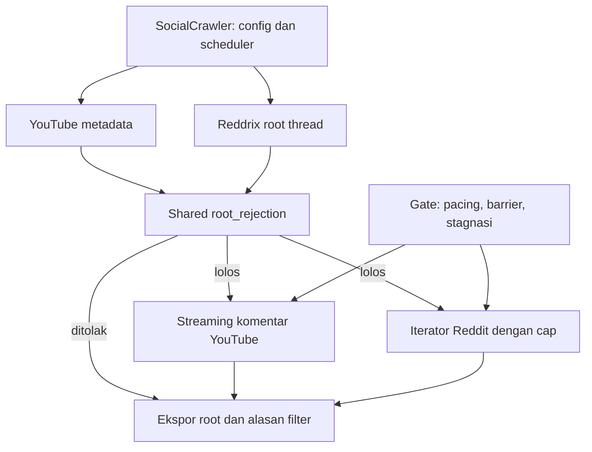

# Optimasi Crawler YouTube dan Reddit 20261106

SocialCrawler 1.11.0 membagikan kebijakan root sebelum pengambilan komentar ke
adapter YouTube 0.2.0 dan collector Reddrix 1.2.14. Kontrak ekspor tetap sama.

YouTube mengirim komentar satu per satu dan memakai pencarian lazy. Reddit
menutup iterator tepat pada cap, metadata-only atau root ditolak. GET/POST
Reddrix diserialisasi dan retry tersembunyi SDK dinonaktifkan; inisialisasi hanya
satu percobaan. HTTP 403/429/5xx menghentikan request berikutnya. `Retry-After`
diteruskan ke coordinator; stagnasi 75 detik menghasilkan `PARTIAL` pada batas
request. Interval internal minimum 1 detik tetap berlaku.

Fixture offline terhadap fungsi baseline commit: YouTube 20→10 halaman komentar
sintetis dengan 101 ID hasil sama; Reddit 20→1 dengan 11 ID hasil sama. Timeout
YouTube mempertahankan 2 komentar yang sebelumnya hilang. Ini bukan benchmark
live atau jaminan bebas blokir. Belum ada crawl live YouTube/Reddit baru.

96 tes: 94 lulus, 2 SDK opsional dilewati, termasuk 21 tes boundary baru.
Lint/format, compile, dry-run dan CLI lulus. No migration required. Allowlist
Docker memuat modul baru; daemon tidak tersedia dan image belum dibangun ulang.
Cooldown lintas restart dan reuse browser Reddit belum diimplementasikan.

Source: `Crawler/Backend/social_crawler.py`,
`Crawler/Backend/Youtube/crawl_youtube.py`,
`Crawler/Backend/Youtube/youtube_runtime.py`,
`Crawler/Backend/crawler_network.py`.
Rincian: `docs/crawler/PERFORMANCE_YOUTUBE_REDDIT_20261106.md`.

Terhubung dengan [[Optimasi Crawler X dan Instagram 20261106]],
[[TikTok Throughput 20261106]] dan [[HOME]].
